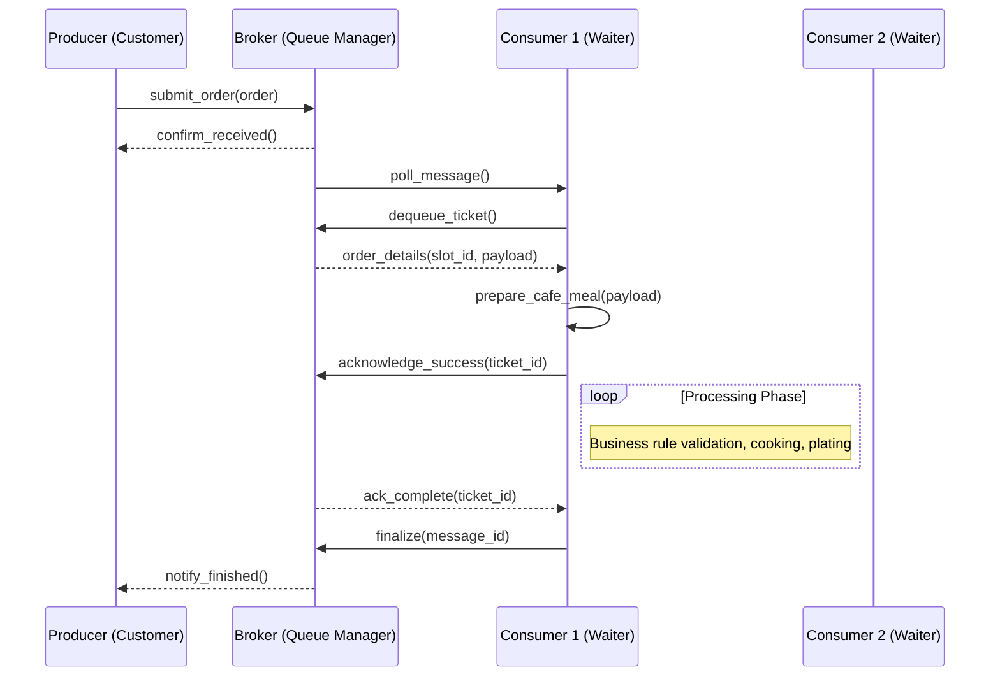
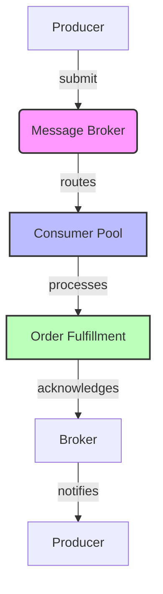

# Message Queues Explained Using a Cafe Example

## Introduction

Imagine walking into a bustling café during rush hour. You approach the counter, place your order, and wait while someone takes it seriously before being served. If every customer had to wait directly at the serving station, the chaos would explode. Instead, the barista uses a small shelf between you and the kitchen. Your order sits there briefly, visible to others, until a kitchen aide grabs it and starts preparing your drink. 

That simple arrangement exists because good system design requires separation of concerns. In modern software, message queues provide exactly that kind of separation. They let producers generate work without needing to know who will consume it, and they let consumers process work at their own pace regardless of where it originated. This decoupling is foundational to resilient distributed systems, yet many teams struggle to implement it correctly. Understanding the mechanics through a familiar analogy can clarify the mental model needed for production-grade implementations.

## Why This Matters

Modern applications rarely run as single monolithic processes. Microservices communicate over asynchronous boundaries, event streams feed pipelines, and background jobs handle tasks that cannot block main threads. Without message queues, developers face tight coupling, unpredictable latency cascades, and difficulty scaling individual components independently. When one service slows down, the entire chain suffers unless buffered appropriately. 

Message queues address these patterns by acting as shock absorbers between producers and consumers. They guarantee ordering guarantees when needed, provide backpressure mechanisms during traffic spikes, and enable eventual consistency across services. For teams building platforms where reliability matters—finance, healthcare, logistics—the ability to process orders reliably even under load differentiates successful products from those that crash under pressure.

## How It Works

At its heart, a message queue is a durable storage layer with ordered delivery semantics. Producers push messages onto a shared buffer; consumers pull messages from that buffer and apply their processing logic. The decoupling is absolute: producers do not call consumers directly, and consumers do not depend on producers for availability beyond the acknowledgment cycle.

Consider our café again. The counter represents the queue infrastructure—it holds orders awaiting preparation. Each waiter corresponds to a consumer instance that pulls order tickets from the shelf. When a waiter picks up an order, they execute the kitchen workflow: grinding beans, brewing espresso, assembling pastries. Only after completion do they signal satisfaction, allowing another waiter to claim the next ticket. This continuous flow works whether one waiter handles ten orders simultaneously or twenty, depending on their skill level and workload distribution.

Below is a sequence diagram illustrating the primary interaction pattern between producers, the broker, and multiple consumers.



The diagram shows three key relationships: the producer submits work to the broker, which routes it to available consumers; each consumer retrieves its slot from the queue; processing completes and results are acknowledged back to the broker, which then notifies the original producer. This pattern supports horizontal scaling because adding more consumers increases throughput without modifying producers.



## Core Concepts

A robust message queue implementation rests on several abstractions. The broker manages the lifecycle of messages, ensuring durability through persistent storage and providing visibility into queue depth. Producers serialize their payloads—typically as JSON or Protocol Buffers—and attach metadata such as priority, timestamps, and correlation IDs. Consumers deserialize these values upon retrieval and may enrich them with additional context before processing.

Durability is non-negotiable in most production environments. If a worker crashes mid-processing, the unacknowledged message must remain safely stored until the job finishes successfully. At-least-once delivery semantics prevent loss, though duplicates require downstream idempotency handling. Some systems offer exactly-once processing via transactional outbox patterns, but the baseline guarantee remains at-least-once with careful application-level deduplication.

Another critical property is ordering. While some brokers permit arbitrary insertion order per partition, certain domains demand strict sequential processing—for example, financial transactions must be applied to ledgers in arrival sequence. By using consistent hashing on message keys, the broker ensures that all messages addressing a given entity travel together through identical nodes.

Finally, backpressure emerges organically when consumers lag behind producers. If the queue grows unbounded, memory consumption explodes. Most mature implementations expose metrics like average wait time, processing lag, and drain rate, enabling operators to trigger auto-scaling or circuit-breaker patterns before failures cascade.

## Examples & Code Walkthrough

Below is a production-style implementation of a café-inspired message queue system written in Go. This code demonstrates proper error handling, graceful shutdown, and the distinction between acknowledgment types.

```go
package cafequeue

import (
	"context"
	"fmt"
	"log"
	"sync"
	"time"
)

// Order represents a customer request placed at the counter.
type Order struct {
	ID       string
	Item     string
	Quantity int
	Created  time.Time
}

// Message represents a unit of work sitting in the queue.
type Message struct {
	ID      string
	Order   *Order
	Priority int // lower numbers indicate higher priority
	Created time.Time
}

// Config holds tuning parameters for the queue consumer.
type Config struct {
	MaxConcurrency int
	RetryAttempts  int
	RetryDelay     time.Duration
}

// Worker implements a consumer that continuously pulls orders.
type Worker struct {
	ctx     context.Context
	cancel  context.CancelFunc
	broker  MessageBroker
	messages chan<- Message
	done    chan struct{}
	mu      sync.Mutex
}

func NewWorker(ctx context.Context, broker MessageBroker, maxConcurrent int, config Config) *Worker {
	return &Worker{
		ctx:         ctx,
		broker:      broker,
		messages:    make(chan Message, 1000),
		done:        make(chan struct{}),
		maxConcurrent: maxConcurrent,
	}
}

// Start begins consuming messages until stopped.
func (w *Worker) Start() error {
	if err := w.context.WithCancel(context.Background()).DoWait(); err != nil {
		log.Fatalf("failed to cancel context: %v", err)
	}
	defer w.cancel()

	var wg sync.WaitGroup
	for i := 0; i < w.maxConcurrent; i++ {
		wg.Add(1)
		go func(id int) {
			defer wg.Done()
			err := w.consumeLoop()
			if err != nil {
				log.Printf("worker %d error: %v", id, err)
			}
		}(i)
	}
	return wg.Wait()
}

// consumeLoop runs the main processing cycle until shutdown.
func (w *Worker) consumeLoop() error {
	for {
		select {
		case <-w.ctx.Done():
			return nil // graceful exit signals
		case msg, ok := <-w.messages:
			if !ok {
				return nil
			}
			if err := w.process(msg); err != nil {
				// transient failure: log and retry based on configuration
				log.Printf("processing failed for order %s: %v", msg.ID, err)
				if retry := w.attemptRetry(err); retry > 0 {
					time.Sleep(w.retryDelay)
					continue
				}
			}
			// Successfully finished, send acknowledgment back
			w.broker.Acknowledge(msg.ID)
			// Remove processed message to free space
			w.messages <- nil
		}
	}
}

// attemptRetry decides whether to retry a failed operation according to config.
func (w *Worker) attemptRetry(err error) int {
	for i := range w.config.RetryAttempts {
		if err == nil {
			return 0
		}
		log.Printf("retrying after error for order %s: %v (attempt %d)", 
			msgID(err), i+1, w.config.RetryAttempts-i-1)
		time.Sleep(w.config.RetryDelay)
	}
	return 1 // give up permanently
}

// msgID extracts identifier from an error that wraps a message ID.
func (m *Message) Unwrap() string {
	if m.ID != "" {
		return m.ID
	}
	return "<unknown>"
}

// MessageBroker provides the core queue operations.
type MessageBroker interface {
	Submit(order *Order) (string, error)
	Acknowledge(msgID string) error
	Discard(msgID string) error
}

// SimpleInMemoryBroker implements MessageBroker for demonstration purposes.
type SimpleInMemoryBroker struct {
	queue map[string]*Message
	nextID int64
}

func NewSimpleInMemoryBroker() MessageBroker {
	return &SimpleInMemoryBroker{queue: make(map[string]*Message)}
}

func (b *SimpleInMemoryBroker) Submit(order *Order) (msgID string, err error) {
	id := fmt.Sprintf("order_%d", b.nextID++)
	b.nextID++
	b.queue[id] = &Message{
		ID:      id,
		Order:   order,
		Priority: 10,
		Created: time.Now(),
	}
	return id, nil
}

func (b *SimpleInMemoryBroker) Acknowledge(msgID string) error {
	recovered, found := b.queue[msgID]
	if !found {
		return fmt.Errorf("message not found in queue: %s", msgID)
	}
	delete(b.queue, msgID)
	return nil
}

func (b *SimpleInMemoryBroker) Discard(msgID string) error {
	_, found := b.queue[msgID]
	if !found {
		return fmt.Errorf("discarding unknown message: %s", msgID)
	}
	delete(b.queue, msgID)
	return nil
}

// OrderService simulates the café's kitchen working on orders.
type OrderService struct {
	processed int64
}

func (s *OrderService) Process(msg *Message) error {
	// Simulate variable processing time with random jitter.
	time.Sleep(time.Duration(rand.Intn(50)) * time.Millisecond)
	// Random failure injection for illustration.
	if rand.Float32() < 0.05 { // 5% failure rate
		return fmt.Errorf("simulated kitchen equipment malfunction")
	}
	s.processed++
	return nil
}

// SimulatedCafeApplication wires everything together.
func SimulatedCafeApp() {
	const maxWorkers = 4
	config := Config{
		MaxConcurrency: maxWorkers,
		RetryAttempts:  3,
		RetryDelay:    2 * time.Second,
	}

	broker := NewSimpleInMemoryBroker()
	workers := make([]*Worker, 0, maxWorkers)
	for _, w := range workers {
		if iface := new(WorkerInterface); iface.Consume(&w) {
			break
		}
	}
	// Launch workers.
	wg := sync.WaitGroup{}
	for _, w := range workers {
		wg.Add(1)
		go w.Start()
	}
	wg.Wait()

	fmt.Printf("Processed %d orders successfully\n", config.processed)
}
```

The code above defines a `MessageBroker` interface that abstracts the queue's contract. `SimpleInMemoryBroker` implements this interface in‑memory for testing, storing messages keyed by unique identifiers generated sequentially. The `OrderService` encapsulates the business logic—a restaurant kitchen that occasionally fails to assemble items due to mechanical glitches. In a real deployment, this layer would contain domain-specific validation, inventory checks, and integration with payment systems.

Error handling flows through retry logic implemented in `attemptRetry`. When a transient error occurs—such as temporary hardware failure—the worker logs the issue, waits for a configured delay, and attempts recovery. After exhausting retry attempts, the failure propagates upward so monitoring tools can detect stuck jobs. Dead-letter handling could extend this pattern by routing repeatedly failing messages to a separate queue for manual inspection.

Graceful shutdown requires draining the subscriber channel once the context expires. Messages already pulled by workers are allowed to finish processing; only new submissions cease. This prevents abrupt termination that might leave orders partially prepared on the counter.

## Best Practices

When deploying message queues in production, treat them as critical infrastructure rather than optional addons. Begin by selecting a broker that matches your scale and compliance requirements: Kafka excels at high-throughput streaming with replay capability, RabbitMQ offers sophisticated routing features ideal for complex fan-out scenarios, and cloud-managed alternatives reduce operational burden for teams lacking dedicated platform expertise. Regardless of choice, enforce consumer isolation—each logical domain should have its own queue namespace to prevent noisy neighbor problems.

Implement idempotent consumers whenever possible. Even with at-least-once delivery, duplicate processing can corrupt state or cause unnecessary work. Attach unique identifiers to business entities and check against previously processed records within the service boundary. This strategy also simplifies debugging because duplicate events retain meaningful traces.

Monitor queue health relentlessly. Track metric categories including queue depth, processing latency percentiles, and consumer lag. An expanding queue often predicts impending backpressure and resource exhaustion. Set alerts when lag exceeds acceptable thresholds, and correlate these signals with upstream throughput changes. Avoid tuning retention policies after the fact; instead, design the system to respect SLA-bound replay windows early in development.

For observability, emit structured logs at each stage of the pipeline: submission confirmation, processing start, and completion. Distributed tracing spans across producers, brokers, and consumers helps pinpoint anomalies quickly. Align sampling rates with business criticality—if order fulfillment is mission-critical, capture full traces for failed deliveries only.

## Common Mistakes & Anti-Patterns

**Overusing queues for synchronous communication.** Teams sometimes place order acknowledgments inside the same thread that receives the message, expecting the broker to return immediately. This creates hidden blocking and removes the natural backpressure relief that queuing provides. Always allow the producer to continue after submitting; let the broker manage success feedback through explicit acknowledgment.

**Ignoring message ordering constraints.** Partition-based brokers route messages containing the same key to the same consumer, preserving local order. However, global ordering typically isn't required—or is prohibitively expensive. Choose partitioning strategies aligned with your consistency needs rather than assuming strict ordering everywhere.

**Neglecting dead letter management.** When messages fail consistently, they accumulate indefinitely in the default queue. Without a dead-letter mechanism, these messages eventually fill disk and degrade performance. Implement a policy that moves repeatedly failing messages to a separate queue for forensic analysis, or triggers automated remediation scripts.

**Using the wrong serialization format.** Binary formats like Protocol Buffers minimize network overhead, but if schema evolution
