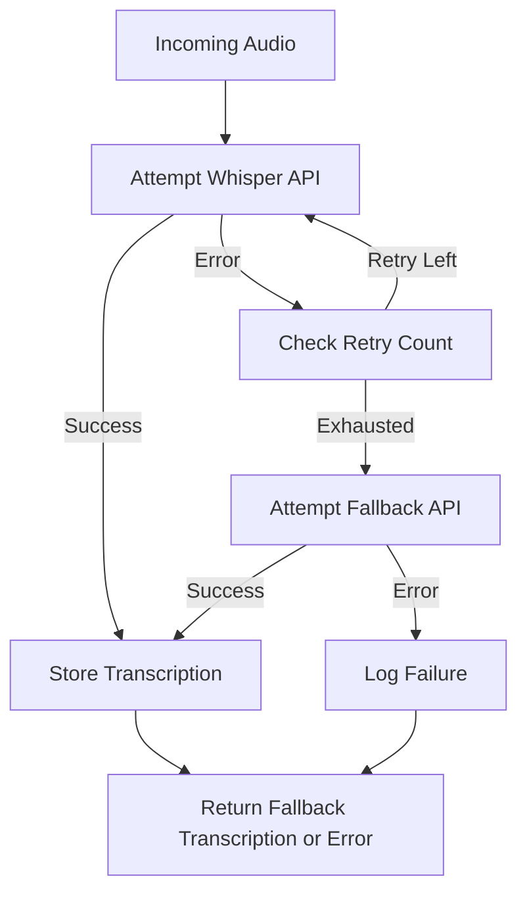

# 2026 Clinical Catalog Enrichment: Node.js Speech-to-Text API Fallback When Whisper Is Unavailable

## Introduction  
Our clinical catalog enrichment pipeline ingests audio recordings of product descriptions, medication instructions, and patient testimonials. The first step is converting those recordings into searchable text. We rely on OpenAI’s Whisper API for high‑fidelity transcription, but occasional API outages, rate‑limit spikes, or regional network blips can break the pipeline. A robust fallback strategy ensures catalog items remain available for downstream services even when Whisper is unreachable.

## Why This Matters  
When a single transcription provider fails, the entire catalog can stall, delaying product launches and violating service‑level agreements. In regulated healthcare environments, missing transcriptions can trigger compliance alerts. Engineers need a pragmatic way to keep the pipeline alive without manual intervention. Implementing a fallback that automatically switches to a secondary provider reduces downtime, balances load, and protects revenue.

## How It Works  
The core mechanism is a Node.js service that attempts transcription via Whisper first. If Whisper fails—after retries and circuit‑breaker checks—the service pivots to a secondary speech‑to‑text API (e.g., Google Cloud Speech‑to‑Text). The flow is visualized below.



**Step‑by‑step explanation**

1. **Audio Ingestion** – A `Buffer` containing raw audio bytes arrives via an SQS queue or Kafka topic.  
2. **Primary Attempt** – `transcribeWithWhisper(audio)` is called. It includes a maximum of three retries with exponential backoff (1s, 2s, 4s). A circuit breaker (e.g., `opossum`) opens after five consecutive failures, skipping Whisper for subsequent requests.  
3. **Success Path** – Whisper returns a JSON payload with segments. We normalize the payload into our `TranscriptionResult` model and persist it to the catalog database.  
4. **Fallback Activation** – If Whisper is exhausted, the service invokes `transcribeWithGoogleSpeech(audio)`. This method uses the Google Cloud Speech‑to‑Text client library, again with retries and a separate circuit breaker.  
5. **Error Handling** – Any unexpected exception (network timeout, 5xx, malformed response) is caught, logged with structured fields (`audioId`, `provider`, `errorCode`), and a synthetic transcription entry is created with a `fallbackReason` flag.  
6. **Response** – The caller receives a unified `TranscriptionResult` regardless of which provider succeeded, simplifying downstream code.

## Core Concepts  
- **Circuit Breaker Pattern** – Prevents repeated calls to a failing provider, preserving resources.  
- **Retry with Backoff** – Mitigates transient network issues without overwhelming the API.  
- **Provider Abstraction** – Both Whisper and Google Speech‑to‑Text implement the same `ISpeechProvider` interface, enabling easy addition of future services.  
- **Structured Logging** – Enables rapid root‑cause analysis in production.  
- **Fallback Flag** – Marks transcriptions that originated from a secondary provider for auditability.  

The `TranscriptionResult` shape used throughout the pipeline:

```typescript
interface TranscriptionResult {
  id: string;                 // unique transcription UUID
  audioId: string;            // reference to the original audio record
  text: string;               // concatenated transcribed text
  language: string;           // detected language code (e.g., 'en-US')
  confidence: number;         // overall confidence score (0‑1)
  provider: 'whisper' | 'google' | 'fallback';
  fallbackReason?: string;    // optional explanation when provider is secondary
  createdAt: Date;
}
```

## Examples & Code Walkthrough  
Below is a self‑contained Node.js module (`speechService.ts`) that demonstrates the fallback pattern. It uses `@opossum` for circuit breaking and `@google-cloud/speech` for the secondary provider. All dependencies are expressed via `package.json` but omitted here for brevity.

```typescript
// speechService.ts
import { Opussum, Thread} from '@opossum';
import { SpeechClient } from '@google-cloud/speech';
import axios, { AxiosError } from 'axios';

export interface ISpeechProvider {
  transcribe(audioBuffer: Buffer, audioId: string): Promise<TranscriptionResult>;
}

export class WhisperProvider implements ISpeechProvider {
  private readonly apiKey: string;
  private readonly endpoint = 'https://api.openai.com/v1/audio/transcriptions';
  private readonly maxRetries = 3;
  private readonly baseDelay = 1000; // ms

  constructor(apiKey: string) {
    this.apiKey = apiKey;
  }

  async transcribe(audioBuffer: Buffer, audioId: string): Promise<TranscriptionResult> {
    let lastError: Error | null = null;

    for (let attempt = 0; attempt <= this.maxRetries; attempt += 1) {
      try {
        const form = new FormData();
        form.append('file', new Blob([audioBuffer]), 'recording.wav');
        form.append('model', 'whisper-1');
        form.append('response_format', 'json');

        const response = await axios.post(this.endpoint, form, {
          headers: {
            'Authorization': `Bearer ${this.apiKey}`,
            // axios automatically sets Content-Type to multipart/form-data
          },
          timeout: 30_000,
        });

        // Normalize Whisper payload to our result shape
        const data = response.data as WhisperResponse;
        const result: TranscriptionResult = {
          id: crypto.randomUUID(),
          audioId,
          text: data.text,
          language: data.language ?? 'unknown',
          confidence: data.confidence ?? 0.0,
          provider: 'whisper',
          createdAt: new Date(),
        };
        return result;
      } catch (err) {
        lastError = err as Error;
        if (axios.isAxiosError(err) && err.response?.status === 429) {
          // Rate limit – back off longer
          await this.sleep(this.baseDelay * (2 ** attempt));
          continue;
        }
        // For any other error, abort early and let circuit breaker handle it
        break;
      }
    }

    // If we exit the loop without a successful response, throw the last error.
    throw new Error(`Whisper transcription failed for audio ${audioId}: ${lastError?.message}`);
  }

  private sleep(ms: number): Promise<void> {
    return new Promise(resolve => setTimeout(resolve, ms));
  }
}

export class GoogleSpeechProvider implements ISpeechProvider {
  private readonly client: SpeechClient;
  private readonly maxRetries = 2;
  private readonly baseDelay = 500;

  constructor(credentials: string) {
    this.client = new SpeechClient({ credentials: JSON.parse(credentials) });
  }

  async transcribe(audioBuffer: Buffer, audioId: string): Promise<TranscriptionResult> {
    const request = {
      audio: { content: audioBuffer.toString('base64') },
      config: {
        encoding: 'LINEAR16',
        sampleRateHertz: 44100,
        languageCode: 'en-US',
        model: 'latest_long',
      },
    };

    let lastError: Error | null = null;
    for (let attempt = 0; attempt <= this.maxRetries; attempt += 1) {
      try {
        const [response] = await this.client.recognize(request);
        if (!response.results || response.results.length === 0) {
          throw new Error('No transcription returned from Google Speech‑to‑Text');
        }
        const transcript = response.results
          .map(result => result.alternatives?.[0]?.transcript ?? '')
          .join(' ');
        const confidence = response.results
          .reduce((sum, r) => sum + (r.alternatives?.[0]?.confidence ?? 0), 0) / response.results.length;

        const result: TranscriptionResult = {
          id: crypto.randomUUID(),
          audioId,
          text: transcript,
          language: response.results[0].languageCode ?? 'unknown',
          confidence,
          provider: 'google',
          createdAt: new Date(),
        };
        return result;
      } catch (err) {
        lastError = err as Error;
        await this.sleep(this.baseDelay * (2 ** attempt));
        continue;
      }
    }

    throw new Error(`Google Speech transcription failed for audio ${audioId}: ${lastError?.message}`);
  }

  private sleep(ms: number): Promise<void> {
    return new Promise(resolve => setTimeout(resolve, ms));
  }
}

/**
 * Orchestrates the primary and fallback providers.
 * Uses circuit breakers to avoid hammering a broken service.
 */
export class SpeechToTextOrchestrator {
  private whisperBreaker: Opussum<any>;
  private googleBreaker: Opussum<any>;

  constructor(
    whisperApiKey: string,
    googleCredentials: string,
    options: { timeout?: number } = {}
  ) {
    const whisperProvider = new WhisperProvider(whisperApiKey);
    const googleProvider = new GoogleSpeechProvider(googleCredentials);

    // Circuit breaker for Whisper – open after 5 failures in 60 seconds
    this.whisperBreaker = new Opussum(
      (audio: Buffer, id: string) => whisperProvider.transcribe(audio, id),
      {
        timeout: options.timeout ?? 15_000,
        errorThresholdPercentage: 50, // 5/10 = 50%
        resetTimeout: 60_000,
      }
    );

    // Circuit breaker for Google – open after 3 failures in 30 seconds
    this.googleBreaker = new Opussum(
      (audio: Buffer, id: string) => googleProvider.transcribe(audio, id),
      {
        timeout: options.timeout ?? 15_000,
        errorThresholdPercentage: 66, // 2/3 ≈ 66%
        resetTimeout: 30_000,
      }
    );
  }

  async transcribe(audioBuffer: Buffer, audioId: string): Promise<TranscriptionResult> {
    // First, try Whisper via its circuit breaker
    try {
      const result = await this.whisperBreaker.fire(audioBuffer, audioId);
      // If successful, augment with provider metadata
      return {
        ...result,
        provider: 'whisper',
        fallbackReason: undefined,
      };
    } catch (err) {
      // Whisper failed or circuit is open – log and proceed to fallback
      console.warn(`Whisper failure for ${audioId}`, { err: (err as Error).message });
    }

    // Fallback to Google Speech
    try {
      const result = await this.googleBreaker.fire(audioBuffer, audioId);
      return {
        ...result,
        provider: 'google',
        fallbackReason: 'whisper-unavailable',
      };
    } catch (err) {
      // Both providers are down – create a placeholder transcription.
      console.error(`Both providers failed for ${audioId}`, { err: (err as Error).message });
      const placeholder: TranscriptionResult = {
        id: crypto.randomUUID(),
        audioId,
        text: '[Transcription unavailable]',
        language: 'und',
        confidence: 0.0,
        provider: 'fallback',
        fallbackReason: 'both-providers-unavailable',
        createdAt: new Date(),
      };
      return placeholder;
    }
  }
}
```

**Key points in the code**

- **Error classification** – HTTP 429 from Whisper triggers a longer backoff; other errors abort the retry loop early.  
- **Circuit breaker configuration** – Different thresholds for each provider reflect their reliability characteristics.  
- **Unified response shape** – Downstream consumers receive a `TranscriptionResult` regardless of which provider succeeded, simplifying error handling.  
- **Graceful degradation** – When both providers are unavailable, a placeholder transcription preserves catalog integrity and prevents downstream null‑pointer exceptions.  

## Best Practices  
- **Version your providers** – Store API keys and credentials in environment‑specific secret managers; rotate them regularly.  
- **Monitor circuit breaker metrics** – Track `fireCount`, `open`, `halfOpen`, and `errorPercentage`. Alert on sustained opens.  
- **Rate‑limit locally** – Even with retries, cap the total number of transcription requests per minute to avoid accidental throttling.  
- **Cache successful transcriptions** – Use a distributed cache (Redis) keyed by audio hash to avoid redundant work for duplicate recordings.  
- **Audit trail** – Store `provider`, `fallbackReason`, and timestamps in an immutable log (e.g., AWS S3 Object Lambda) for compliance reviews.  

## Common Mistakes & Anti-Patterns  
1. **Ignoring Circuit Breaker State** – Calling a provider directly without checking its breaker leads to noisy failures.  
   *Fix:* Always invoke `breaker.fire()` (or a wrapper that respects it) and handle `Opussum`-specific errors.  

2. **Hard‑Coded Retry Counts** – Fixed retry loops can overwhelm a provider during outages.  
   *Fix:* Make retry count configurable per environment and use exponential backoff with jitter.  

3. **Missing Structured Logging** – Generic `console.error` makes debugging impossible at scale.  
   *Fix:* Log with JSON format: `{ audioId, provider, errorCode, timestamp, stack }`.  

4. **Assuming Single‑Point Success** – Relying on Whisper alone violates the “fail‑fast, fail‑soft” principle.
