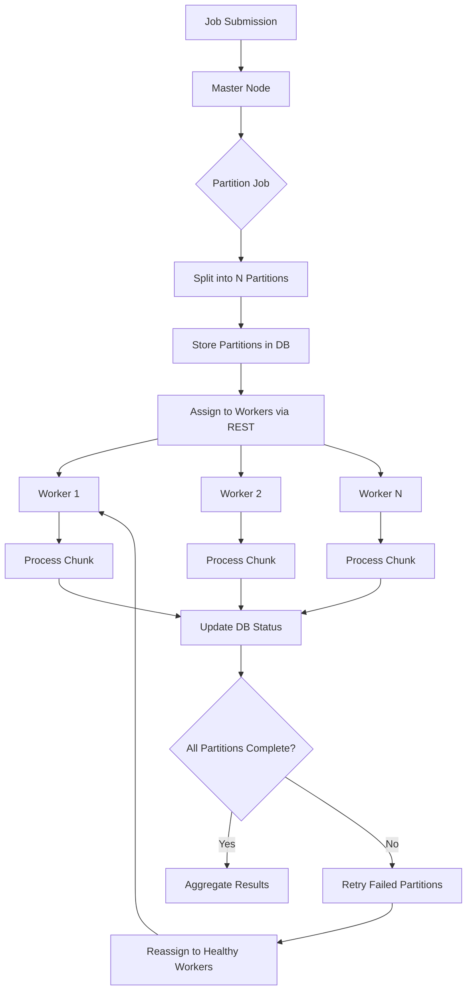

# Article: Distributed Spring Batch Without a Message Broker

## Introduction

Batch processing at scale has always been a balancing act between throughput, fault tolerance, and operational complexity. For years, the default answer to "how do I parallelize a Spring Batch job across multiple nodes?" was to introduce a message broker—Kafka, RabbitMQ, or even AWS SQS. The broker becomes the coordination backbone: it holds partition metadata, dispatches work, and collects results. But every broker you add is another moving part to monitor, secure, version, and debug. In our production clusters at scale, we've seen broker-induced latency spikes during rebalances, partition leadership flaps that stall jobs for minutes, and the operational burden of running a ZooKeeper ensemble just so a nightly ETL can finish before the business day starts.

What if we could keep the horizontal scaling but drop the broker entirely? Spring Batch's built-in partitioning model, combined with a shared relational database and direct REST communication, gives us exactly that. The master node splits the job, persists partition definitions, and hands out work via HTTP. Workers poll, process, and report back—all without a single message queue in the architecture. This article walks through the design, the code, and the hard-won lessons from running this pattern in anger.

## Why This Matters

If you're running batch workloads on Kubernetes or VMs, you already have a database (PostgreSQL, MySQL, Oracle) and you already have HTTP. Adding a broker means:

*   **Extra infrastructure**: Brokers need disks, memory, replication, and dedicated operators.
*   **Latency tax**: Every partition handoff crosses the broker network hop. For short-lived tasks, serialization and queue latency can dominate actual work time.
*   **Failure domain expansion**: A broker outage pauses *all* batch jobs, not just one. We've lived through a RabbitMQ mirror queue sync that blocked our entire data pipeline for 40 minutes.

By using the database as the source of truth and REST for control-plane traffic, we reduce the failure domains to two well-understood components: the app tier and the DB. The database is already highly available; the app tier scales horizontally behind a load balancer. No new moving parts.

## How It Works

The core idea is a **master-worker** pattern orchestrated through a shared database. The master (which can be any node that starts the job) writes partition metadata to a `PARTITION_STATUS` table. Workers—identical Spring Boot applications exposing a REST endpoint—poll for unassigned partitions, claim them with an optimistic lock, execute the chunk, and update the status. The master polls the same table to detect completion or failure and reassigns stragglers.

Here's the end-to-end flow:



**Step-by-step breakdown:**

1.  **Job Launch**: A scheduler (or manual trigger) starts the Spring Batch job on one node—the *master* for this execution.
2.  **Partitioning**: The master's `Partitioner` implementation (e.g., `ColumnRangePartitioner`) calculates N disjoint data ranges and inserts rows into `PARTITION_STATUS` with `STATUS = 'PENDING'`.
3.  **Worker Polling**: Each worker runs a scheduled task (or uses Spring Cloud Stream's polling consumer) that calls `GET /partitions/next?workerId=...`. The master (or a dedicated coordinator service) atomically claims a partition via `UPDATE ... SET STATUS='CLAIMED', WORKER_ID=? WHERE STATUS='PENDING' AND VERSION=?`.
4.  **Execution**: The worker receives the partition parameters, executes the chunk-oriented step (reader/processor/writer), and posts the result to `POST /partitions/{id}/complete`.
5.  **Completion**: The master updates the partition row to `COMPLETED` or `FAILED`. Once all partitions reach a terminal state, the master marks the job execution `COMPLETED` and exits.

## Core Concepts

### Master-Worker Roles Are Transient
There is no dedicated "master service." Any node that launches the job becomes the master for that job execution. Workers are stateless and identical. This eliminates leader election complexity—if the launching node dies, the job execution stays in `STARTED` in `BATCH_JOB_EXECUTION`, and a subsequent run (or a Kubernetes job restart) can pick up where it left off because the partition table holds the state.

### Partition Strategies
We use two primary strategies in production:

| Strategy | Use Case | Implementation |
| :--- | :--- | :--- |
| **Column Range** | Large tables with an indexed numeric/date column (e.g., `id`, `created_at`). | `ColumnRangePartitioner` splits `MIN(id)` to `MAX(id)` into equal ranges. |
| **Fixed List** | Reference data, file lists, or shard keys that don't map to ranges. | `ListPartitioner` reads a control table or config and emits one partition per entry. |

Both implement `Partitioner` and return a `Map<String, ExecutionContext>` where the key is the partition name (e.g., `partition-0`) and the context holds `minId`, `maxId`, or `shardKey`.

### Communication: REST over gRPC? We Chose REST
gRPC would save bytes, but REST wins on debuggability. `curl` and `tcpdump` work everywhere; protobuf tooling doesn't. Our payloads are tiny (partition parameters + a few metrics), so the overhead is negligible. We enforce a strict contract with OpenAPI and generate client stubs via `openapi-generator`.

### Database as the Coordination Backbone
The `PARTITION_STATUS` table is the single source of truth. Schema (PostgreSQL dialect):

```sql
CREATE TABLE partition_status (
    partition_id      BIGSERIAL PRIMARY KEY,
    job_execution_id  BIGINT NOT NULL REFERENCES batch_job_execution(job_execution_id),
    partition_name    VARCHAR(100) NOT NULL,
    partition_params  JSONB NOT NULL,      -- minId, maxId, shardKey, etc.
    status            VARCHAR(20) NOT NULL, -- PENDING, CLAIMED, PROCESSING, COMPLETED, FAILED
    worker_id         VARCHAR(100),
    attempts          INT DEFAULT 0,
    version           INT DEFAULT 0,       -- optimistic lock
    created_at        TIMESTAMPTZ DEFAULT now(),
    updated_at        TIMESTAMPTZ DEFAULT now(),
    completed_at      TIMESTAMPTZ,
    error_message     TEXT,
    UNIQUE (job_execution_id, partition_name)
);

CREATE INDEX idx_partition_status_pending ON partition_status (job_execution_id, status) 
    WHERE status IN ('PENDING', 'CLAIMED');
```

Optimistic locking (`version` column) prevents two workers from claiming the same partition. The partial index makes the "find next pending" query fast even with millions of historical rows.

## Examples & Code Walkthrough

### 1. Master-Side Partitioned Step Configuration

This is the heart of the master node. We configure a `PartitionHandler` that *doesn't* use a `TaskExecutor` locally but instead delegates to remote workers via REST.

```java
@Configuration
@EnableBatchProcessing
@RequiredArgsConstructor
public class DistributedBatchConfig {

    private final JobRepository jobRepository;
    private final PlatformTransactionManager transactionManager;
    private final WorkerClient workerClient; // Feign/OpenAPI client
    private final PartitionStatusRepository partitionRepo; // Spring Data JPA

    @Bean
    public Job distributedJob(Step partitionedStep) {
        return new JobBuilder("distributedJob", jobRepository)
                .start(partitionedStep)
                .build();
    }

    @Bean
    public Step partitionedStep(Partitioner partitioner) {
        return new StepBuilder("partitionedStep", jobRepository)
                .partitioner("workerStep", partitioner)
                .gridSize(10) // number of partitions; tune per job
                .partitionHandler(restPartitionHandler())
                .build();
    }

    /**
     * Custom PartitionHandler that orchestrates via REST + DB.
     * Spring Batch expects handle() to block until all partitions finish.
     */
    @Bean
    public PartitionHandler restPartitionHandler() {
        return new PartitionHandler() {
            @Override
            public void handle(StepExecution stepExecution, 
                               StepExecutionRequest request) {
                // 1. Persist partition metadata
                PartitionStatusEntity entity = PartitionStatusEntity.builder()
                        .jobExecutionId(stepExecution.getJobExecutionId())
                        .partitionName(request.getStepExecutionId()) // e.g., "partition-0"
                        .partitionParams(toJson(request.getExecutionContext()))
                        .status(PartitionStatus.PENDING)
                        .build();
                partitionRepo.save(entity);

                // 2. Trigger worker (fire-and-forget; worker polls)
                // We could POST directly, but polling decouples worker lifecycle.
                // Here we just ensure the row exists.
            }

            @Override
            public List<StepExecution> getStepExecutions(StepExecution stepExecution) 
                    throws Exception {
                // Poll until all partitions for this jobExecutionId are terminal
                return waitForCompletion(stepExecution.getJobExecutionId());
            }

            private List<StepExecution> waitForCompletion(Long jobExecutionId) {
                // Poll with exponential backoff, max 30 min
                long start = System.currentTimeMillis();
                while (System.currentTimeMillis() - start < Duration.ofMinutes(30).toMillis()) {
                    List<PartitionStatusEntity> partitions = partitionRepo
                            .findByJobExecutionIdAndStatusNotIn(jobExecutionId, 
                                    List.of(PartitionStatus.COMPLETED, PartitionStatus.FAILED));
                    if (partitions.isEmpty()) {
                        // All done - convert to StepExecution list for Spring Batch
                        return partitionRepo.findByJobExecutionId(jobExecutionId).stream()
                                .map(this::toStepExecution)
                                .collect(Collectors.toList());
                    }
                    // Check for stuck partitions (CLAIMED > 10 min) -> requeue
                    requeueStalePartitions(jobExecutionId);
                    sleep(Duration.ofSeconds(10));
                }
                throw new IllegalStateException("Partition timeout for job " + jobExecutionId);
            }
        };
    }
}
```

**Key points:**
*   `handle()` is called once per partition by the framework. We *only* persist the partition definition here. We do **not** block or call the worker synchronously.
*   `getStepExecutions()` is where the master waits. It polls the DB, requeues stale claims, and returns the aggregated `StepExecution` objects only when every partition is `COMPLETED` or `FAILED`.
*   The `gridSize(10)` determines how many partitions the `Partitioner` produces. Tune this to `(worker_count * cores_per_worker)`.

### 2. Worker REST Controller & Execution Logic

Workers are a separate Spring Boot app (same jar, different profile). They expose two endpoints: one for the master to push (optional) and one for the worker to poll.

```java
@RestController
@RequiredArgsConstructor
@Slf4j
public class WorkerPartitionController {

    private final WorkerPartitionService workerService;
    private final String workerId; // e.g., hostname + PID, injected via @Value("${worker.id}")

    /**
     * Worker calls this periodically (e.g., every 5s via @Scheduled).
     * Returns a partition to process, or 204 No Content if none.
     */
    @GetMapping("/internal/partitions/next")
    public ResponseEntity<PartitionDto> claimNextPartition() {
        return workerService.claimNextPartition(workerId)
                .map(ResponseEntity::ok)
                .orElse(ResponseEntity.noContent().build());
    }

    /**
     * Master (or worker itself) calls this when processing finishes.
     * Idempotent: safe to retry.
     */
    @PostMapping("/internal/partitions/{partitionId}/complete")
    public ResponseEntity<Void> completePartition(
            @PathVariable Long partitionId,
            @Valid @RequestBody PartitionResult result) {
        workerService.completePartition(partitionId, result);
        return ResponseEntity.ok().build();
    }
}
```

```java
@Service
@RequiredArgsConstructor
@Slf4j
public class WorkerPartitionService {

    private final PartitionStatusRepository partitionRepo;
    private final StepExecutor stepExecutor; // wraps Spring Batch's StepExecution
    private final ObjectMapper objectMapper;

    @Transactional
    public Optional<PartitionDto> claimNextPartition(String workerId) {
        // Atomic claim via optimistic lock
        int updated = partitionRepo.claimPendingPartition(workerId);
        if (updated == 0) {
            return Optional.empty();
        }
        // Fetch the claimed row
        PartitionStatusEntity entity = partitionRepo
                .findFirstByWorkerIdAndStatusOrderByCreatedAt(workerId, PartitionStatus.CLAIMED)
                .orElseThrow();
        entity.setStatus(PartitionStatus.PROCESSING);
        partitionRepo.save(entity);
        return Optional.of(toDto(entity));
    }

    @Transactional
    public void completePartition(Long partitionId, PartitionResult result) {
        PartitionStatusEntity entity = partitionRepo.findById(partitionId)
                .orElseThrow(() -> new EntityNotFoundException("Partition " + partitionId));
        
        if (result.isSuccess()) {
            entity.setStatus(PartitionStatus.COMPLETED);
        } else {
            entity.setStatus(PartitionStatus.FAILED);
            entity.setErrorMessage(result.getError());
            entity.setAttempts(entity.getAttempts() + 1);
        }
        entity.setCompletedAt(Instant.now());
        partitionRepo.save(entity);
    }

    /**
     * Executes the actual business logic for a partition.
     * Called by the worker's scheduled task after claimNextPartition().
     */
    @Retryable(retryFor = {TransientDataAccessException.class, RemoteCallException.class}, 
               maxAttempts = 3, backoff = @Backoff(delay = 2000, multiplier = 2))
    public void executePartition(PartitionDto partition) {
        ExecutionContext ctx = fromJson(partition.getPartitionParams());
        StepExecution stepExecution = stepExecutor.execute("workerStep", ctx);
        
        PartitionResult result = PartitionResult.builder()
                .success(stepExecution.getStatus() == BatchStatus.COMPLETED)
                .readCount(stepExecution.getReadCount())
                .writeCount(stepExecution.getWriteCount())
                .error(stepExecution.getFailureExceptions().isEmpty() ? null : 
                        stepExecution.getFailureExceptions().get(0).getMessage())
                .build();
        
        completePartition(partition.getPartitionId(), result);
    }
}
```

**Critical details:**
*   `claimPendingPartition` uses a custom `@Modifying` query: `UPDATE partition_status SET status='CLAIMED', worker_id=:workerId, version=version+1 WHERE status='PENDING' AND version=:version`. This is the *only* place we mutate `status` to `CLAIMED`.
*   The worker moves the row to `PROCESSING` immediately after claim so the master knows it's active.
*   `@Retryable` on `executePartition` handles transient DB deadlocks or downstream service blips. We *don't* retry business logic failures (e.g., data corruption)—those go to `FAILED` and alerting picks them up.

### 3. The Actual Chunk Step (Business Logic)

This runs *inside the worker JVM*. It's a standard Spring Batch chunk step, but the reader is parameterized by the partition's `minId`/`maxId`.

```java
@Configuration
@RequiredArgsConstructor
public class WorkerStepConfig {

    private final JobRepository jobRepository;
    private final PlatformTransactionManager txManager;
    private final DataSource dataSource; // same DB as master

    @Bean
    @JobScope // crucial: each partition gets its own reader instance
    public ItemReader<Customer> partitionReader(
            @Value("#{stepExecutionContext['minId']}") Long minId,
            @Value("#{stepExecutionContext['maxId']}") Long maxId) {

        JdbcCursorItemReader<Customer> reader = new JdbcCursorItemReader<>();
        reader.setDataSource(dataSource);
        reader.setSql("SELECT id, email, tier FROM customers WHERE id BETWEEN ? AND ? ORDER BY id");
        reader.setPreparedStatementSetter(ps -> {
            ps.setLong(1, minId);
            ps.setLong(2, maxId);
        });
        reader.setRowMapper((rs, rowNum) -> new Customer(
                rs.getLong("id"), rs.getString("email"), rs.getString("tier")));
        reader.setFetchSize(500); // tune for your row size
        return reader;
    }

    @Bean
    public ItemProcessor<Customer
