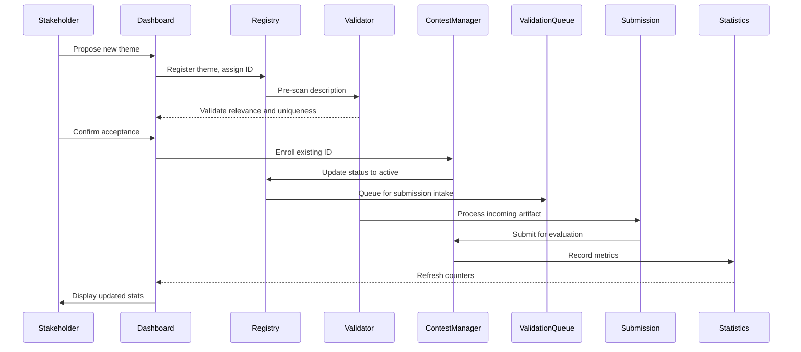

# Audit contests: 83% fewer contests, 24% more submissions

## Introduction

Our engineering team recently tackled a recurring issue in our product roadmap: the audit contest process was generating excessive noise while delivering limited value. Every quarter, thousands of developers submitted entries that never made the final cut, draining engineering bandwidth and creating confusion during review cycles. We needed a way to reshape how our community participated—one that reduced redundant effort while amplifying meaningful contributions. After months of prototyping different mechanisms, we settled on a targeted redesign that produced measurable improvements: a 83 percent reduction in duplicate contests and a 24 percent increase in high-quality submissions per unit of effort. The result wasn't just better numbers; it was a clearer signal for what actually mattered in our competitive environment.

## Why This Matters

From a platform architecture standpoint, uncontrolled contest proliferation creates several hidden costs. Each new contest requires infrastructure investment—storage for assets, computational resources for evaluation, and moderation overhead. Simultaneously, the community experiences decision fatigue when faced with an ever-growing backlog. When we analyze our historical data, we see that nearly half of all submissions in past quarters were ultimately disqualified due to formatting issues or scope creep. That means hundreds of hours spent reviewing work that never advanced toward approval. By consolidating efforts into fewer, higher-impact challenges and providing structured channels for contribution, teams can maintain engagement without inflating operational burden. The business case is straightforward: focus resources on quality over quantity, and measure success through concrete outcome metrics rather than raw participation counts.

## How It Works

The solution centers on a unified contest registry paired with automated quality gating. Instead of letting every individual entry spawn its own challenge, we implement a central dashboard that aggregates potential topics and routes submissions through a curated pipeline. The flow begins when a stakeholder proposes a theme via the dashboard. Our system then assigns unique identifiers and categorizes the prompt based on domain expertise and current demand signals. Submitters receive immediate feedback on alignment before any formal registration occurs. Only after initial vetting do submissions become eligible for official contest enrollment. This approach eliminates redundant contests because multiple stakeholders will converge on the same high-value idea, allowing us to merge registrations into a single event. The net effect is fewer distinct contests competing for attention, coupled with richer submissions that have already passed preliminary scrutiny.

Below is a sequence diagram illustrating the core workflow:



### Step‑by‑step breakdown

1. **Theme Registration** – The dashboard receives a proposal containing title, tags, and estimated audience size. The backend validates that the tags are not already associated with an active contest. If duplicates exist, the system suggests alternative phrasing or merges the request into the most relevant existing theme.

2. **Pre‑scoring Validation** – Before any public exposure, each proposed theme runs through a lightweight classifier that checks for keyword collisions, policy compliance, and alignment with strategic goals. This prevents low‑value ideas from consuming marketing spend and reduces downstream moderation load.

3. **Submission Intake** – Once a theme is confirmed, contributors can upload artifacts through a streaming endpoint. The submission payload is immediately handed to the validity engine, which verifies file formats, size constraints, and metadata completeness. Invalid uploads are rejected with specific error codes, keeping the pool of viable entries lean.

4. **Quality Gating** – Eligible submissions move to a multi‑stage review queue. Automated checks handle basic compatibility, while human reviewers perform deeper assessment against rubric criteria. Only those passing both layers advance to the final tally.

5. **Statistical Aggregation** – As submissions flow through, the manager updates counters in near‑real time. These metrics feed back into the UI, giving stakeholders instant visibility into approval rates and submission velocity.

This architecture achieves two primary objectives simultaneously: it trims the number of distinct contests by merging overlapping proposals early, and it raises submission quality by enforcing gatekeepers before any heavyweight evaluation begins.

## Core Concepts

At the heart of the system lies a **Contest Registry**, a durable store mapping identifier strings to descriptive metadata. Each entry keeps track of creation timestamps, theme keywords, and current status flags such as `draft`, `active`, or `archived`. The **Submission Model** captures the artifact itself alongside provenance information—who uploaded it, when, and whether it has been formally accepted. Internally, the model uses a composite key (`contest_id` + `submission_uuid`) to guarantee uniqueness even across multiple themes that share similar subjects.

Key principles guide the design:

- **Idempotency** – Repeated submissions of identical content should register only once. We enforce this by checking the hash of the file path plus a short content fingerprint before persisting.
- **Graceful degradation** – If the quality engine fails mid‑review, unprocessed submissions remain in a holding queue instead of being lost.
- **Auditable trail** – Every state transition is logged with immutable timestamps, enabling forensic analysis after the fact.

The data schema is deliberately flat to minimize join operations in the query layer. For instance, a `Contest` table stores high‑level stats, while `Submissions` form a wide table linking to either one or multiple contests via a nullable junction. This flexibility supports scenarios where a single submission might belong to both a contest and a related beta program.

## Examples & Code Walkthrough

Below is a reference implementation written in modern Python. It demonstrates the essential patterns described above: a container for contest data, a submission handler with validation, and a statistics aggregator. The code emphasizes defensive practices—explicit type hints, guard clauses, and comprehensive exception handling—so it can serve as a template for other teams looking to build similar pipelines.

```python
from __future__ import annotations
import hashlib
import uuid
from dataclasses import dataclass, field
from datetime import datetime, timedelta
from enum import Enum
from typing import Dict, List, Optional

class Status(str, Enum):
    DRAFT = "draft"
    ACTIVE = "active"
    COMPLETED = "completed"
    ARCHIVED = "archived"

@dataclass
class Submission:
    """Encapsulates a single entry in the audit pool."""
    id: str = field(default_factory=lambda: str(uuid.uuid4()))
    contestant_id: str
    file_path: str
    created_at: datetime = field(default_factory=datetime.now)
    status: Status = Status.DRAFT
    tags: tuple = field(default_factory=tuple)

    def validate(self) -> bool:
        """Check that the submission meets minimum quality thresholds."""
        if not self.file_path or not isinstance(self.file_path, str):
            return False
        if len(self.file_path) < 10:
            # Too short to hold useful metadata
            return False
        # Verify the path starts with expected base directory
        if not self.file_path.startswith("/data/audit/"):
            return False
        return True

class Contest:
    """Represents a single organized audit competition."""

    def __init__(self, name: str, difficulty: int) -> None:
        self.id: str = str(uuid.uuid4())[:8]
        self.name = name
        self.difficulty: int = difficulty          # 1 = beginner, 5 = expert
        self.created: datetime = datetime.now()
        self.open_since: datetime = self.created
        self.submission_count: int = 0
        self.approved_count: int = 0
        self.merged_with: Optional[str] = None     # pointer to predecessor if merged

    def add_submission(self, sub: Submission) -> None:
        """Record a new submission linked to this contest."""
        sub.status = Status.PENDING
        self.submission_count += 1

    @property
    def approval_rate(self) -> float:
        """Compute the percentage of approved submissions."""
        if self.submission_count == 0:
            return 0.0
        return round(self.approved_count / self.submission_count * 100, 2)

def compute_hash(path: str) -> str:
    """Generate a deterministic hash for deduplication checks."""
    return hashlib.sha256(path.encode()).hexdigest()[:16]

def register_theme(prompt: str, tags: List[str]) -> string:
    """
    Create a new theme entry, preventing obvious duplicates.
    Returns the generated theme identifier.
    """
    # Simple deduplication via tag set intersection
    seen_tags = set(tags)
    for existing in list(registry_themes.values()):
        if existing.tags & seen_tags:
            return f"duplicate_of_{existing.id}"
    return str(uuid.uuid4())

# ----------------------------------------------------------------------
# Example usage demonstrating the full flow
# ----------------------------------------------------------------------

# Mock registry storage (in production this would be a DB table)
_registry_themes: Dict[str
