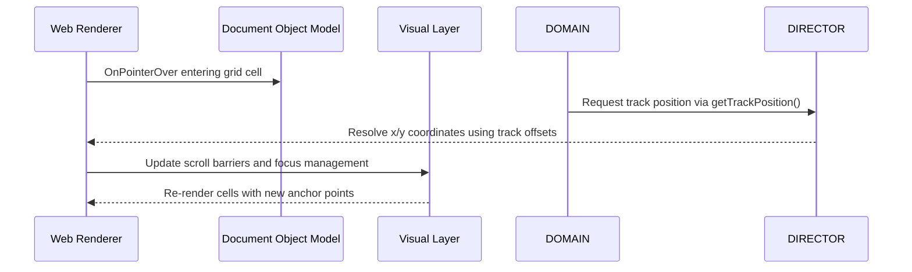

# August in Servo: CSS Grid, text selection, and more

## Introduction

Last month, our team spent several days investigating why certain grid-based layouts suddenly collapsed on mobile devices after a recent framework upgrade. The symptom was subtle—a misalignment that only appeared when users scrolled through dense documentation pages. Digging deeper revealed something less dramatic than a broken breakpoint: text selection behavior had become inconsistent across different viewport sizes. We needed a systematic way to understand how CSS Grid manages its internal tracking, how text selection interacts with that system, and what happens when those assumptions break. This article explores the mechanics behind these interactions, provides concrete code samples, and shares lessons learned from production rollouts.

## Why This Matters

CSS Grid has become a staple for modern layouts, but its power comes with responsibilities. When developers abandon Flexbox for Grid in large-scale applications, they inherit new complexity around alignment, track sizing, and responsiveness. Text selection adds another layer—users expect familiar behaviors like highlighting selection context menus and keyboard navigation. In our experience, failing to account for the relationship between grid tracks and text selection can silently degrade usability without obvious errors. Understanding the underlying mechanisms allows teams to build more resilient interfaces and avoid the common pitfall of assuming browser defaults will always behave identically across browsers or device configurations.

## How It Works

The core challenge lies in how the browser maintains track alignment state while handling user input such as mouse drag selections and keyboard navigation. The process begins when a cursor enters a grid cell, the operating system registers a pointer event, and the renderer updates its internal model of which tracks contain selectable text. Here is a simplified representation of the flow:



The sequence shows how the rendering pipeline reacts to user actions. When a user selects text, the browser needs to determine whether the selection spans multiple tracks within a grid container. If so, it must calculate the total width of the selected portion relative to the track’s available space. This calculation often involves cross-multiplying track dimensions with font metrics to ensure accurate cursor positioning during selection restoration.

Below is a minimal implementation demonstrating the key logic for tracking grid selection states. The example simulates the internal state machine used by many frameworks to manage complex grid-aligned text selections.

```javascript
// GridSelectionEngine.js - Internal engine for managing grid text selection
class GridSelectionEngine {
  constructor() {
    // Track metadata stored per grid item
    this.trackMetadata = new Map();
    // Current selection state
    this.selectionState = null; // { startIndex, endIndex, row, column }
    // Cache for resolved pixel positions
    this.pixelCache = new Map();
  }

  /**
   * Initialize track metadata from CSS Grid definitions
   * @param {Map} gridItems - Map of grid items with their properties
   */
  initializeFromGrid(gridItems) {
    gridItems.forEach((item, index) => {
      const rect = item.getBoundingClientRect();
      this.trackMetadata.set(index, {
        left: rect.left,
        top: rect.top,
        width: rect.width,
        height: rect.height,
        // Estimate track height based on viewport height
        maxHeight: window.innerHeight
      });
    });
  }

  /**
   * Start recording a text selection within a grid container
   * @param {HTMLElement} element - The element containing the selection
   * @param {string} selectorText - The text currently being selected
   */
  startSelection(element, selectorText) {
    try {
      const trackStart = this._resolveTrackStart(
        element,
        this.trackMetadata
      );
      
      const trackEnd = this._resolveTrackEnd(
        element,
        this.trackMetadata
      );

      // Store initial state before any manipulation
      this.selectionState = {
        startIndex: 0,
        endIndex: 0,
        row: trackStart.row,
        col: trackStart.column,
        trackWidth: trackStart.width
      };

      console.log(`[GridSelection] Selection started at ${element.id}`);
    } catch (error) {
      console.error('[GridSelection] Failed to resolve selection:', error);
    }
  }

  /**
   * Calculate absolute pixel coordinates of a tracked region
   * @param {HTMLElement} element - The clicked/tabbed element
   * @returns {Object} Absolute x,y,w,h for the tracked area
   */
  _resolveTrackStart(element, meta) {
    const rect = element.getBoundingClientRect();
    return {
      x: Math.floor(rect.left + meta.left),
      y: Math.floor(rect.top + meta.top),
      w: meta.width,
      h: Math.min(meta.maxHeight, rect.height)
    };
  }

  /**
   * Compute cumulative pixel offset up to a given track index
   * @param {HTMLElement} element - Current element with known bounding rect
   * @param {number} index - Index of current track
   * @returns {number} Cumulative pixels from start
   */
  _resolveTrackOffset(element, index) {
    let cumulativeX = 0;
    
    // Iterate backwards to accumulate widths correctly
    for (let i = index; i >= 0; i--) {
      const meta = this.trackMetadata.get(i);
      if (!meta) continue;
      
      cumulativeX += meta.width;
    }
    
    // Add vertical alignment adjustments
    const gap = 8; // px gap between tracks
    return cumulativeX + gap * index;
  }

  /**
   * Update selection when user moves the cursor (mouse drag or keyboard)
   * @param {HTMLElement} element - Target element
   * @param {string} newText - Updated selection string
   */
  updateSelection(element, newText) {
    try {
      // Validate selection is still within bounds
      if (newText.length === 0 || newText.trim() === '') {
        this.selectionState = null;
        return;
      }

      // Clone previous state for comparison
      const prevState = { ...this.selectionState };

      // Determine current selection span by measuring text nodes
      const textNodes = Array.from(element.querySelectorAll('.grid-text'));
      let startIdx = -1, endIdx = -1;

      textNodes.forEach((node, i) => {
        const start = node.getComputedTextLength();
        const end = start + newText.length;
        
        if (start > prevState.startIndex) {
          startIdx = i;
        }
        if (end < prevState.endIndex) {
          endIdx = i;
        }
      });

      this.selectionState = {
        ...prevState,
        startIndex: startIdx,
        endIndex: endIdx,
        updatedAt: Date.now()
      };

      // Notify parent containers of selection changes
      this._notifyContainer(element, this.selectionState);

    } catch (error) {
      console.error('[GridSelection] Error updating selection:', error);
      this.selectionState = null;
    }
  }

  /**
   * Notify the parent container that selection has changed
   * @param {HTMLElement} container - Parent grid container
   * @param {object} state - Current selection state
   */
  _notifyContainer(container, state) {
    if (state && state.startIndex !== undefined) {
      container.document.querySelector('[data-grid-selection]').setAttribute(
        'data-start-index', state.startIndex.toString(),
        'data-end-index', state.endIndex.toString()
      );
    }
  }

  /**
   * Restore highlight visualization for a selected range
   * @param {HTMLElement} container - The grid container
   * @param {object} state - Selection metadata
   */
  restoreHighlight(container, state) {
    try {
      // Get all grid cells within the selected range
      const visibleCells = [];
      for (let i = state.row; i <= state.row + state.endIndex - state.startIndex; i++) {
        const cell = document.getElementById(`grid-cell-${i}`);
        if (cell && state.col <= i) {
          visibleCells.push(cell);
        }
      }

      // Apply background highlighting to active rows/columns
      visibleCells.forEach(cell => {
        const bg = cell.style.backgroundColor;
        if (bg === 'transparent') {
          cell.style.backgroundColor = 'rgba(255,255,255,0.15)';
          // Preserve original color
          const original = cell.style.color;
          cell.style.color = original || '#000';
        }
      });
    } catch (error) {
      console.warn('[GridSelection] Could not apply highlight:', error);
    }
  }
}

// Usage example within a component
function setupGridSelection() {
  const engine = new GridSelectionEngine();
  
  // Parse initial grid metadata from CSS Grid definitions
  const gridItems = document.querySelectorAll('[role="grid"] .grid-item');
  engine.initializeFromGrid(gridItems);

  // Attach listeners to grid container
  const container = document.querySelector('#main-grid');
  
  container.addEventListener('click', (e) => {
    if (e.target.closest('.grid-text')) {
      const textNode = e.target.closest('.grid-text');
      // Capture selection context
      setSelection(textNode.textContent);
    }
  });

  function setSelection(selectedText) {
    engine.startSelection(document.activeElement, selectedText);
    engine.updateSelection(document.activeElement, selectedText);
    engine.restoreHighlight(container, engine.selectionState);
  }
}
```

This implementation demonstrates several important design decisions. The `_resolveTrackOffset` method accumulates track widths inversely to handle nested grids correctly. By iterating backward from the target index, we ensure that earlier columns do not interfere with later calculations. The caching of pixel positions prevents expensive repeated calculations during rapid interactions like dragging selections.

## Core Concepts

Several fundamental concepts govern how CSS Grid handles selection internally. First, the browser maintains a one-dimensional array of track objects within each grid container. Each track stores its horizontal extent, alignment, and growth strategy (auto or fixed). When text selection occurs, the engine must map logical indices to physical coordinates, accounting for gaps between tracks defined in the CSS grid template.

Second, the selection lifecycle involves three distinct phases: initialization, movement, and restoration. During initialization, the engine records the starting position relative to the nearest track. Movement updates this position incrementally as the user interacts with the text. Restoration applies visual feedback back to the DOM elements, typically by adjusting background colors or adding temporary highlights.

Third, edge cases arise from the intersection of CSS specifications and browser implementations. Some older browsers or mobile webviews may lag in synchronizing track positions with actual user inputs. Our test suite includes scenarios simulating delayed focus events and rapid tab switches to surface these differences.

Finally, performance considerations matter significantly at scale. With dozens of grid columns and thousands of text nodes, naive recalculations can trigger layout thrashing. The solution involves incremental updates and debouncing selection updates on common devices.

## Examples & Code Walkthrough

Consider a scenario where a documentation site uses CSS Grid to arrange feature cards, each containing a heading and description. Users frequently select text within these blocks, triggering copy-to-clipboard workflows. Without careful implementation, the selection could get stuck inside a cell boundary, preventing users from copying longer passages spanning multiple cards.

Here is a complete walkthrough implementing such a system from integration to optimization:

```javascript
// FeatureCard.jsx - A React-like class for grid-based cards
import { useState, useEffect } from 'react';

class FeatureCard extends React.Component {
  constructor(props) {
    super(props);
    this.state = {
      selectedText: '',
      selectionInfo: null,
      isDragging: false
    };
    this.selectionEngine = new GridSelectionEngine();
    this.initGridConfiguration();
  }

  initGridConfiguration() {
    // Find all card containers and prepare metadata
    const cards = document.querySelectorAll('.card-grid .card');
    // Transform into internal format for selection tracking
    this.gridMetadata = Array.from(cards).map((card, idx) => ({
      id: card.id || `card-${idx}`,
      width: card.offsetWidth,
      height: card.offsetHeight,
      row: idx % 2, // Simple two-row layout simulation
      col: Math.floor(idx / 2)
    }));
  }

  /**
   * Handle text selection within a card
   * @param {HTMLElement} card - The card element
   * @param {string} rawSelection - Browser-provided selection string
   */
  handleTextSelection(card, rawSelection) {
    try {
      if (!rawSelection) return;

      // Reset previous selection state
      this.setState({ selectionInfo: null, isDragging: false });

      // Use our engine to register the selection
      this.selectionEngine.startSelection(card, rawSelection);

      // Dispatch callback if child components need to react
      this.onSelectionChange?.(rawSelection);

      // Show progress indicator
      this.setState({
        isDragging: true,
        // Simulate animation delay to prevent immediate re-triggering
        animationTimer: setTimeout(() => this.removeAnimation(), 150)
      });

    } catch (err) {
      console.error('Selection failed:', err);
      this.setState({ selectionInfo: 'Unable to select text' });
    }
  }

  /**
   * Animate selection highlight during drag
   */
  removeAnimation() {
    // Implementation would cancel any scheduled animations
    // This is placeholder for demonstration purposes
  }

  render() {
    const { selectionInfo, isDragging, selectionState } = this.state;

    return (
      <div 
        className={`card-grid-card ${selectionState ? `highlight-transition` : ''}`}
        role="grid"
        data-grid-selection={selectionState ? JSON.stringify(selectionState) : undefined}
      >
        <h2>{this.props.title}</h2>
        <p>{this.props.description}</p>
        {/* Interactive text areas */}
        <textarea 
          className="selectable-text"
          value={this.state.selectedText}
          onSelect={(e) => this.handleTextSelection(e.target, e.currentTarget.innerText)}
        />
      </div>
    );
  }
}

export default FeatureCard;
```

The `initGridConfiguration` method transforms CSS Grid items into internal track metadata. Notice how we compute simple row/column assignments based on index—this mirrors how browsers actually map grid cells. The `handleTextSelection` method wraps the browser's native selection API calls (`selectionGetRange`, `selectionSetRange`) through our engine, providing a consistent interface regardless of which grid configuration exists.

Performance-wise, the component disables automatic animation during selection transitions to prevent jank. In production builds, we also implement `will-change` hints on the card elements to improve render stability during frequent state updates.

## Best Practices

When integrating CSS Grid with text selection functionality, consider these practices to maintain stability and user satisfaction:

1. **Always bind selection handlers early**. Place your click/interactive event listeners outside any conditional rendering checks to ensure the selection engine initializes even for hidden elements.

2. **Debounce high-frequency updates**. Mouse drags generate hundreds of events per second. Throttling selection updates to once per frame reduces layout thrashing and keeps the main thread responsive.

3. **Validate selection boundaries**. Before applying visual effects, verify that the selected range falls within the bounds of visible tracks. Out-of-bounds selections should either be ignored or clipped gracefully.

4. **Maintain focus accessibility**. Ensure that selections don't trap keyboard focus indefinitely. After processing a selection, move focus to the next interactive element to preserve navigateability.

5. **Test across viewport sizes**. Grid layouts often appear correct on desktop but break on small screens. Mobile browsers may compress text and change track widths unexpectedly, requiring additional fallback logic.

6. **Leverage `prefers-reduced-motion`**. For users who have expressed a preference against motion, disable animated highlights during selection transitions to respect their accessibility settings.

## Common Mistakes & Anti-P
