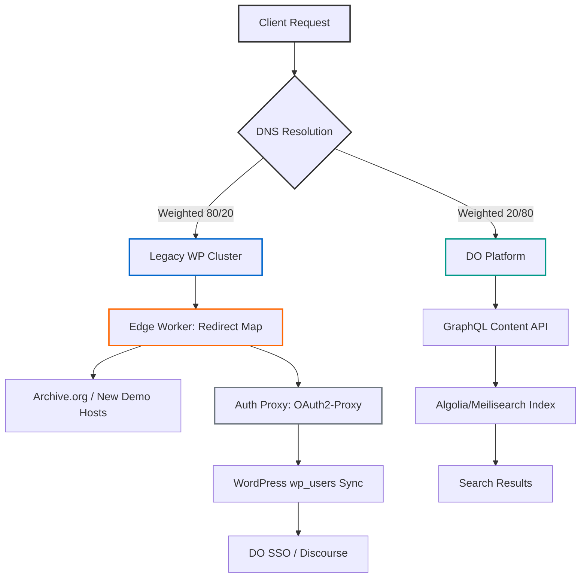

# CSS-Tricks has a new owner

## Introduction

For sixteen years, CSS-Tricks stood as a quiet monument to a particular era of web development. Founded by Chris Coyier, it became a go-to resource for front-end engineers navigating the transition from table-based layouts to modern CSS, JavaScript frameworks, and the ever-shifting landscape of browser support. When the announcement broke that DigitalOcean had acquired the property, the reaction across Lobste.rs and developer circles was immediate: a mix of nostalgia, curiosity about the platform’s future, and technical questions about how a 16-year-old WordPress monolith would migrate to a corporate infrastructure.

I want to set aside the press-release narrative. Instead, I’ll treat this as a systems-level post-mortem: what was actually acquired, how the migration is being engineered, and what production-grade patterns emerge from the transition. The core thesis is that this isn’t a “sale” in the traditional sense—it’s a strangler fig migration. The “fig” is the community and content corpus; the “host” is a bespoke WordPress/PHP stack; and the “knife” is the systematic transfer of institutional knowledge from a single point of failure to a distributed engineering team.

## Why This Matters

Why should software engineers and architects care about a content site changing hands? Because CSS-Tricks encodes patterns that are broadly applicable to any organization wrestling with legacy digital assets, community trust, and infrastructure modernization.

From a practical standpoint, the acquisition highlights three production-scale pain points:

1. **The `Bus Factor` risk.** For sixteen years, the site’s content, architecture, and roadmap lived primarily in one person’s expertise. The migration to DigitalOcean’s engineering organization is effectively a `Bus Factor` reduction from ~1 to N. That’s a meaningful shift in organizational risk posture.

2. **Structured content extraction.** The “Almanac” section—curated CSS property documentation with browser support matrices—isn’t just articles. It’s a semi-structured knowledge graph embedded in WordPress taxonomies. Separating that from the narrative blog layer and re-indexing it for a headless platform is a data-engineering problem that scales to any team migrating from a monolithic CMS to a modular stack.

3. **SEO and link continuity.** Sixteen years of content means thousands of external references, CodePen embeds, and demo hosts that no longer exist. Preserving ranking signals while migrating DNS and re-platforming is an edge‑cache and redirect‑engineering challenge.

In short: this is a case study in how to move a high‑visibility, long‑tail content ecosystem without collapsing traffic, breaking community trust, or losing decades of accumulated technical knowledge.

## How It Works

The migration strategy hinges on a phased “strangler fig” approach rather than a big‑bang cutover. The diagram below illustrates the core mechanism: DNS weighted routing sits in front of both the legacy WordPress stack and the new DigitalOcean platform, with edge workers handling redirect logic, auth proxying, and content syndication during the transition period.



**Step-by-step, the mechanism works as follows:**

1. **DNS Weighted Routing.** Cloudflare or Route53 serves split traffic. 80% routes to the existing WordPress stack, 20% to the new DigitalOcean platform. This allows us to monitor error rates, traffic patterns, and SEO signals without an abrupt break.

2. **Edge Worker Redirect Map.** A Cloudflare Workers script runs regex matching against requested URLs. Old CodePen embeds, demo host links, and parameter‑heavy article URLs are rewritten to archive.org mirrors or new DO‑hosted equivalents. This runs at the edge, avoiding origin load during the transition.

3. **Auth Proxy & User Sync.** An OAuth2‑Proxy or Authelia sidecar sits in front of the legacy WordPress installation. It handles session translation between WordPress’s `wp_users`/`wp_usermeta` tables and DigitalOcean’s OIDC/SAML identity provider. A nightly batch job, with a fallback real‑time webhook, syncs user metadata so that logged‑in experiences remain consistent.

4. **Almanac Extraction & Headless API.** The property‑graph data—CSS property names, values, browser support matrices—is extracted from WordPress taxonomies and written into a PostgreSQL database with JSONB columns. A GraphQL API surface exposes this data to the new DO Learn platform, decoupling the structured knowledge from the narrative blog layer.

5. **Search Index Re‑indexing.** Algolia or Meilisearch re‑indexes the full content corpus. We preserve `objectID` stability for “Related Articles” widgets by mapping old IDs to new ones via a lookup table, ensuring that internal linking widgets don’t break during the cutover.

6. **Observability & 404 Budget.** A budget of 404s per day is established based on historical crawl data. Edge workers automatically attempt resolution via archive.org. Any uncached misses trigger a Slack alert to the migration team, ensuring broken links are surfaced and addressed within a defined SLA.

This approach lets us treat the migration as a controlled experiment rather than a gamified deployment.

## Core Concepts

Understanding the migration requires unpacking a few technical pillars that defined the original architecture and dictate the migration path.

**The Content Lake.** CSS-Tricks’ WordPress install houses roughly 4,000 posts across three custom post types: `post` (standard articles), `video` (embedded screencasts), and `almanac` (structured CSS property entries). Each post type has a distinct schema in the `wp_posts` table, but they share a common metadata layer via Advanced Custom Fields (ACF). The ACF flex‑field groups define “article blocks”—reusable layout units that determine how text, code snippets, and embedded media compose a page. Migrating this means either replicing the block renderer in the new stack or exporting the rendered HTML for static export.

**The Almanac Sub‑system.** This is the most structurally interesting component. Each property entry (e.g., `background-color`, `flex-basis`) is a custom post with taxonomies for: property name, associated CSS module, browser versions supporting each value, and “support status” (full, partial, none). The relationship graph is: `Property` → `Values` → `Browser Support Matrix`. This is effectively a knowledge graph stored in WordPress’s EAV‑like taxonomy system. Migrating it without losing the semantic relationships requires a deliberate data‑model redesign—typically a PostgreSQL schema with JSONB for the support matrix, plus a normalization layer for query performance.

**Technical Debt Ledger.** The stack runs PHP 7.4 with compatibility shims for 8.0. The `wp-cron` system handles newsletter digests and scheduled post publishes, which doesn’t scale well beyond a single server instance. The media library has an S3 offload plugin, but local filesystem drift has created orphaned files that aren’t reflected in the database. These are the kinds of infrastructural debts that surface during migration and require systematic remediation.

## Examples & Code Walkthrough

### Snippet A: The Flexible Content Renderer

The following mu‑plugin replaces `the_content()` filtering and handles the ACF Flexible Content “block” architecture that drives article layouts. During migration, this logic will be ported to a React component library, but the PHP renderer remains useful for legacy page rendering and static export.

```php
<?php
/**
 * File: mu-plugins/ct-flexible-renderer.php
 * 
 * Provides a the_content() filter that iterates ACF Flexible Content blocks
 * and renders corresponding template parts. Enables granular layout control
 * without Gutenberg dependency, and serves as the migration boundary
 * between the old WP renderer and the new headless component library.
 */

defined( 'ABSPATH' ) or die;

// Guard: only run on the front end, and only for supported post types.
if ( ! is_singular( ['ct_article', 'ct_video', 'ct_almanac'] ) ) {
    return;
}

/**
 * Main renderer filter. Hooked at priority 99 to run after default WP filters,
 * but before any child‑theme the_content overrides.
 *
 * @param string $content The original post content (HTML from editor or ACF output).
 * @return string Rendered HTML combining editor content + ACF block layout.
 */
function ct_render_flexible_blocks( $content ) {
    // If the editor content is empty, we rely entirely on ACF blocks.
    // This happens for Almanac entries built purely from the flex field.
    if ( empty( $content ) ) {
        $content = '';
    }

    $blocks = get_field( 'article_blocks' ); // ACF Flexible Field return

    if ( empty( $blocks ) ) {
        // No ACF blocks fall back to original content; caller can further process.
        return $content;
    }

    ob_start();

    foreach ( $blocks as $block ) {
        // Layout name is stored as 'block_<component>', strip prefix.
        $layout_key = $block['acf_fc_layout'];
        $component  = str_replace( 'block_', '', $layout_key );

        // Sanitize component name to prevent path traversal.
        if ( ! preg_match( '/^[a-z0-9_-]+$/i', $component ) ) {
            continue; // Skip malformed block definitions.
        }

        // Template-part hierarchy: template-parts/blocks/block-{name}.php
        // Allows child-theme override via WP template hierarchy.
        $template_path = 'template-parts/blocks/block-' . $component . '.php';

        // Verify template exists to avoid fatal errors.
        if ( ! locate_template( [ $template_path ] ) === '' ) {
            // Extract only the data fields we want to expose to the template.
            // We pass the raw block array but strip ACF internal keys.
            $template_data = array_diff_key( $block, [ 'acf_fc_layout' => '' ] );

            // load_template handles WP template loading with proper escaping.
            // ph
