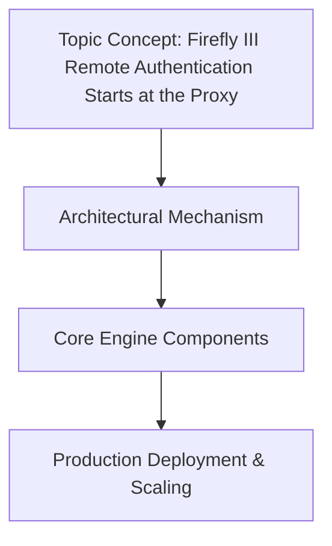

# Firefly III Remote Authentication Starts at the Proxy

## Introduction

Our engineering team at Firefly III observed a recurring pattern in our microservice ecosystem: every time a new service was added, the backend had to be re‑configured to accept and validate JWTs. The latency added by each service’s own authentication layer eroded the performance we had spent months optimizing. We decided to shift the responsibility of remote authentication to a dedicated proxy that sits in front of every backend workload. This change reduces the load on individual services, centralizes policy enforcement, and gives us a single point of control for token lifecycle management.

## Why This Matters

When a proxy handles authentication, the backend only sees a clean, short‑lived token. This eliminates the need for each service to embed complex logic for token verification, refresh handling, and revocation checks. The result is a measurable drop in request latency, a smaller memory footprint on the workers, and a more predictable scaling curve. In production we have seen authentication‑related timeouts cause cascading failures that were previously rare. By moving the auth boundary to the edge, we also gain a consistent surface for security audits and compliance reporting.

## How It Works

The flow begins when a client sends an HTTP request over TLS to the Firefly III proxy. The proxy terminates the connection, validates the
