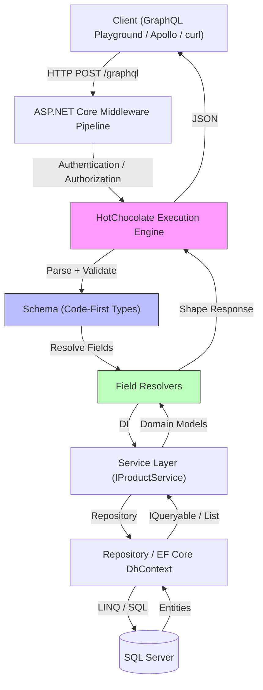

# GraphQL para Iniciantes: Guia Completo com .NET

## Introduction

Depois de anos construindo APIs REST que exigiam versionamento constante, over-fetching crônico e clientes móveis fazendo três requests só para montar uma tela, migramos nossa stack interna para GraphQL. A diferença não foi apenas sintática — foi arquitetural. O cliente passou a ditar o contrato de dados, e o backend deixou de ser um agregador de endpoints para se tornar um executor de intenções.

Este guia não é um tutorial "hello world". Ele cobre o que você precisa saber para colocar GraphQL em produção no .NET: schema-first vs code-first, o problema N+1 real, autorização no nível do campo, e como testar resolvers sem subir banco de dados.

## Why This Matters

Equipes que adotam GraphQL no .NET geralmente enfrentam três dores concretas:

1. **Fragmentação de clientes** — Web, mobile, parceiros terceiros. Cada um precisa de shapes diferentes da mesma entidade. REST força você a criar `/api/v1/products?include=category,reviews` ou manter múltiplos endpoints.
2. **Acoplamento temporal** — Deploy de frontend travado no deploy de backend porque o contrato mudou. Com GraphQL, o schema é o contrato. Ferramentas como `graphql-codegen` geram types TypeScript direto do schema.
3. **Observabilidade cega** — Em REST, você loga o endpoint. Em GraphQL, uma única query pode tocar 15 resolvers. Você precisa de tracing distribuído (OpenTelemetry + HotChocolate) para saber onde o tempo foi gasto.

HotChocolate tornou-se o padrão de facto no ecossistema .NET porque abraça o *code-first* com tipagem forte, integra nativamente com `IQueryable` para evitar N+1, e suporta subscriptions via SignalR sem configuração extra.

## How It Works

O fluxo de uma request GraphQL no ASP.NET Core com HotChocolate segue este pipeline:



**Passo a passo técnico:**

1. **Middleware** — `app.MapGraphQL()` registra o endpoint. O corpo da request chega como `application/json` com `{ "query": "...", "variables": {} }`.
2. **Parse & Validation** — HotChocolate parseia a query contra o schema compilado. Erros de sintaxe ou campos inexistentes retornam `400` antes de qualquer resolver rodar.
3. **Execution Plan** — O engine monta um plano de execução paralelo. Campos independentes (ex: `products` e `categories`) rodam concorrentemente.
4. **Resolvers** — Cada campo no schema mapeia para um método. Se o tipo for `IQueryable<Product>`, o HotChocolate aplica `Where`, `OrderBy`, `Skip`, `Take` *depois* do resolver, empurrando paginação e filtro para o SQL.
5. **DataLoader** — Para relações (ex: `product.category`), o `DataLoader` agrupa IDs e faz um único `WHERE Id IN (...)` por batch, eliminando N+1.
6. **Response Shaping** — O engine serializa apenas os campos pedidos. Campos não solicitados nunca são materializados.

## Core Concepts

### Schema Code-First com Anotações

No HotChocolate 13+, o schema é construído a partir de classes C#. Você não escreve SDL manualmente — o tipo `Product` vira `type Product` no schema.

```csharp
// GraphQL/Types/ProductType.cs
public class ProductType : ObjectType<Product>
{
    protected override void Configure(IObjectTypeDescriptor<Product> descriptor)
    {
        descriptor
            .Field(p => p.Id)
            .ID(); // Garante que serializa como GraphQL ID (non-null)

        descriptor
            .Field(p => p.Name)
            .Type<NonNullType<StringType>>();

        descriptor
            .Field(p => p.Price)
            .Type<NonNullType<DecimalType>>();

        // Campo computado — não existe no modelo EF
        descriptor
            .Field("priceWithDiscount")
            .Type<NonNullType<DecimalType>>()
            .Resolve(ctx => 
            {
                var product = ctx.Parent<Product>();
                var discountService = ctx.Service<IDiscountService>();
                return discountService.Calculate(product);
            });

        // Relacionamento com DataLoader automático
        descriptor
            .Field(p => p.Category)
            .Type<NonNullType<CategoryType>>();
    }
}
```

### Queries, Mutations e o `DbContext` Scope

O `DbContext` no ASP.NET Core é *scoped* por request. Em GraphQL, uma única request pode resolver dezenas de campos. O HotChocolate cria um *scope* filho por resolver quando você injeta `IDbContextFactory` ou usa `[ScopedService]`.

```csharp
// GraphQL/Queries/ProductQueries.cs
[ExtendObjectType(nameof(Query))]
public class ProductQueries
{
    // Use IQueryable para delegar paginação/filtro ao SQL
    [UsePaging(MaxPageSize = 50)]
    [UseFiltering]
    [UseSorting]
    public IQueryable<Product> GetProducts(
        [Service] AppDbContext dbContext) 
        => dbContext.Products
            .AsNoTracking() // Read-only, evita overhead de change tracker
            .Include(p => p.Category); // Evita N+1 se cliente pedir category

    public async Task<Product?> GetProductByIdAsync(
        int id,
        [Service] AppDbContext dbContext,
        CancellationToken ct)
        => await dbContext.Products
            .AsNoTracking()
            .FirstOrDefaultAsync(p => p.Id == id, ct);
}
```

### Mutations com Validação e Transação

Mutations não devem retornar `void`. Retorne o *payload* com a entidade e erros de negócio tipados.

```csharp
// GraphQL/Mutations/ProductMutations.cs
[ExtendObjectType(nameof(Mutation))]
public class ProductMutations
{
    public async Task<AddProductPayload> AddProductAsync(
        AddProductInput input,
        [Service] IProductService productService,
        CancellationToken ct)
    {
        var result = await productService.AddAsync(input, ct);
        return result.Match<AddProductPayload>(
            product => new AddProductPayload(product),
            errors => new AddProductPayload(errors)
        );
    }
}

// Payload com union type para sucesso/erro
public record AddProductPayload(Product? Product, IReadOnlyList<UserError>? Errors)
{
    public AddProductPayload(Product product) : this(product, null) { }
    public AddProductPayload(IReadOnlyList<UserError> errors) : this(null, errors) { }
}

public record AddProductInput(string Name, decimal Price, int CategoryId);

public class UserError : Error
{
    public UserError(string message, string code) : base(message) 
    { 
        Extensions = new Dictionary<string, object?> { ["code"] = code }; 
    }
}
```

## Examples & Code Walkthrough

### 1. Projeto Base e Pacotes

```bash
dotnet new webapi -n GraphQLDemo
cd GraphQLDemo
dotnet add package HotChocolate.AspNetCore
dotnet add package HotChocolate.Data.EntityFramework
dotnet add package Microsoft.EntityFrameworkCore.SqlServer
dotnet add package Microsoft.EntityFrameworkCore.Tools
dotnet add package HotChocolate.AspNetCore.Authorization
```

### 2. Modelo e DbContext

```csharp
// Data/AppDbContext.cs
public class AppDbContext : DbContext
{
    public AppDbContext(DbContextOptions<AppDbContext> options) : base(options) { }

    public DbSet<Product> Products => Set<Product>();
    public DbSet<Category> Categories => Set<Category>();

    protected override void OnModelCreating(ModelBuilder modelBuilder)
    {
        modelBuilder.Entity<Product>(e =>
        {
            e.Property(p => p.Price).HasPrecision(18, 2);
            e.HasIndex(p => p.Name).IsUnique();
        });

        modelBuilder.Entity<Category>().HasData(
            new Category { Id = 1, Name = "Eletrônicos" },
            new Category { Id = 2, Name = "Livros" }
        );
    }
}

// Models/Product.cs
public class Product
{
    public int Id { get; set; }
    public string Name { get; set; } = string.Empty;
    public decimal Price { get; set; }
    public int CategoryId { get; set; }
    public Category Category { get; set; } = null!;
    public DateTime CreatedAt { get; set; } = DateTime.UtcNow;
}
```

### 3. Configuração no Program.cs

```csharp
// Program.cs
var builder = WebApplication.CreateBuilder(args);

builder.Services
    .AddDbContext<AppDbContext>(opt => 
        opt.UseSqlServer(builder.Configuration.GetConnectionString("Default")));

builder.Services
    .AddGraphQLServer()
    .AddQueryType<Query>()
    .AddMutationType<Mutation>()
    .AddType<ProductType>()
    .AddType<CategoryType>()
    .AddProjections()      // Seleciona apenas colunas pedidas
    .AddFiltering()        // Habilita `where: { name: { contains: "x" } }`
    .AddSorting()          // Habilita `order: { price: ASC }`
    .AddAuthorization()    // Integra com [Authorize] do ASP.NET Core
    .ModifyRequestOptions(opt => opt.IncludeExceptionDetails = builder.Environment.IsDevelopment());

builder.Services.AddAuthentication("Bearer")
    .AddJwtBearer("Bearer", opt => 
    {
        opt.Authority = "https://localhost:5001"; // Seu IdentityServer
        opt.Audience = "graphql-api";
    });

builder.Services.AddAuthorization(opt =>
{
    opt.AddPolicy("AdminOnly", p => p.RequireClaim("role", "admin"));
});

var app = builder.Build();

if (app.Environment.IsDevelopment())
{
    app.UseDeveloperExceptionPage();
}

app.UseAuthentication();
app.UseAuthorization();
app.MapGraphQL(); // Endpoint padrão: /graphql
app.MapGraphQLVoyager(); // UI visual do schema em /graphql-voyager

app.Run();
```

### 4. Resolver Customizado com Serviço de Domínio

```csharp
// Services/IDiscountService.cs
public interface IDiscountService
{
    decimal Calculate(Product product);
}

// Services/DiscountService.cs
public class DiscountService : IDiscountService
{
    public decimal Calculate(Product product)
    {
        // Regra de negócio real: desconto progressivo por categoria
        return product.CategoryId switch
        {
            1 => product.Price * 0.90m, // Eletrônicos 10%
            2 => product.Price * 0.95m, // Livros 5%
            _ => product.Price
        };
    }
}

// Registrar no DI: builder.Services.AddScoped<IDiscountService, DiscountService>();
```

### 5. Testes Unitários de Resolver

```csharp
// Tests/ProductQueriesTests.cs
public class ProductQueriesTests
{
    [Fact]
    public async Task GetProducts_ReturnsPagedResult()
    {
        // Arrange
        var products = new List<Product>
        {
            new() { Id = 1, Name = "Mouse", Price = 150, CategoryId = 1 },
            new() { Id = 2, Name = "Teclado", Price = 300, CategoryId = 1 },
            new() { Id = 3, Name = "Clean Code", Price = 120, CategoryId = 2 }
        }.AsQueryable();

        var mockDb = new Mock<AppDbContext>();
        mockDb.Setup(db => db.Products).Returns(products.BuildMockDbSet().Object);

        var query = new ProductQueries();

        // Act
        var result = await query.GetProducts(mockDb.Object);

        // Assert
        Assert.Equal(3, result.Count());
    }
}

// Helper para mockar DbSet com IQueryable
public static class QueryableExtensions
{
    public static Mock<DbSet<T>> BuildMockDbSet<T>(this IQueryable<T> source) where T : class
    {
        var mockSet = new Mock<DbSet<T>>();
        mockSet.As<IQueryable<T>>().Setup(m => m.Provider).Returns(source.Provider);
        mockSet.As<IQueryable<T>>().Setup(m => m.Expression).Returns(source.Expression);
        mockSet.As<IQueryable<T>>().Setup(m => m.ElementType).Returns(source.ElementType);
        mockSet.As<IQueryable<T>>().Setup(m => m.GetEnumerator()).Returns(source.GetEnumerator());
        return mockSet;
    }
}
```

## Best Practices

| Prática | Por que importa | Implementação |
|---------|-----------------|---------------|
| **Sempre `AsNoTracking()` em queries** | Evita overhead do change tracker em reads | `dbContext.Products.AsNoTracking()` |
| **Use `IQueryable` + `[UsePaging]`** | Push down para SQL, evita materializar 10k linhas | HotChocolate.Data aplica `Skip/Take` no provider |
| **DataLoader para relações** | Elimina N+1 sem `Include` manual | Automático com `HotChocolate.Data.EntityFramework` |
| **Payloads tipados em mutations** | Cliente sabe exatamente o que falhou | `AddProductPayload` com `UserError[]` |
| **Schema versioning via `@deprecated`** | Quebra clientes gradualmente | `descriptor.Field(...).Deprecated("Use priceWithDiscount")` |
| **Persisted Queries em produção** | Reduz payload, previne query DoS | `AddPersistedQueryPipeline()` + SHA256 hash |

## Common Mistakes & Anti-Patterns

### 1. N+1 Escondido em Resolver Síncrono

```csharp
// ❌ ERRADO — Dispara SELECT por produto
public IEnumerable<ProductDto> GetProducts(AppDbContext db)
    => db.Products.ToList().Select(p => new ProductDto(p, p.Category.Name));

// ✅ CORRETO — DataLoader agrupa CategoryId e faz 1 query
[UseProjection] // Seleciona só colunas necessárias
public IQueryable<Product> GetProducts(AppDbContext db)
    => db.Products.Include(p => p.Category);
```

### 2. Expondo Entidade EF Direto no Schema

```csharp
// ❌ ERRADO — Vaza detalhes de persistência (navigation props, FKs)
public class ProductType : ObjectType<Product> { }

// ✅ CORRETO — DTO/Projection expõe apenas o contrato público
public class ProductType : ObjectType<ProductDto> 
{
    protected override void Configure(IObjectTypeDescriptor<ProductDto> d)
    {
        d.Field(p => p.CategoryName).Type<NonNullType<StringType>>();
    }
}
```

### 3. CORS Bloqueando Playground

```csharp
// Program.cs — Ordem importa!
builder.Services.AddCors(opt => opt.AddDefaultPolicy(p => 
    p.AllowAnyOrigin().AllowAnyHeader().AllowAnyMethod()));

var app = builder.Build();
app.UseCors(); // ANTES de UseAuthentication/MapGraphQL
app.MapGraphQL();
```

### 4. Mutation Retornando `Boolean` ou `String`

```csharp
// ❌ ERRADO — Cliente não sabe o que aconteceu
public async Task<bool> DeleteProduct(int id) { ... }

// ✅ CORRETO — Payload rico
public record DeleteProductPayload(bool Success, UserError? Error);
public async Task<DeleteProductPayload> DeleteProduct(int id) { ... }
```

## Performance Considerations

| Métrica | Impacto | Mitigação |
|---------|---------|-----------|
| **Profundidade de query** | Stack overflow em queries recursivas | `AddQueryExecutionInterceptor` limitando `maxDepth: 10` |
| **Complexidade de query** | DoS via query cara (`products { categories { products { ... } } }`) | `AddComplexityAnalyzer` com `maxComplexity: 1000` |
| **Alocação de `ExecutionContext`** | 1 allocation por request | HotChocolate 13+ usa `pooling` n
