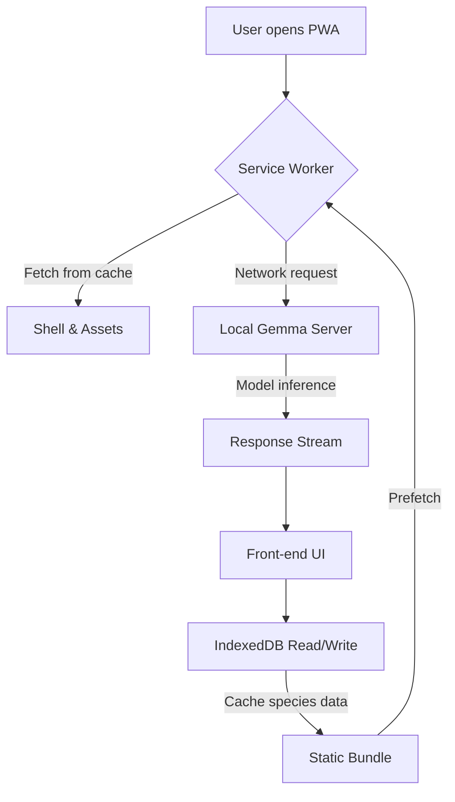

# Guardabosque: an offline nature guide for Tabasco's jungles, powered by Gemma running on my laptop

## Introduction
When you’re deep in the Lacandon rainforest and the cloud disappears, you still need to identify that strange call or the flash of color among the leaves. Traditional field‑guide websites rely on constant connectivity and remote APIs, which break the moment the signal drops. This article shows how to build a fully offline progressive‑web‑app (PWA) that runs on a developer’s laptop, uses the Gemma large language model locally for natural‑language queries, and caches all static data with a service worker and IndexedDB.

## Why This Matters
Engineers building field tools, disaster‑response apps, or any product that must work in low‑connectivity environments face a recurring problem: offline AI inference is either too heavy or requires complex native builds. By keeping the model on the laptop and delivering the UI as a PWA, we get:
* Zero data egress – all prompts stay on the device, preserving privacy.
* No recurring cloud costs – the model runs on existing hardware.
* Instant UI reload – the service worker serves assets from cache, so the guide works even after a reboot.

These benefits translate directly to lower operational overhead and a more reliable user experience for researchers, guides, and tourists working off the grid.

## How It Works
The system consists of three loosely coupled pieces:

1. **Local Gemma server** – a lightweight wrapper around `llama.cpp` that exposes a HTTP endpoint (`/generate`) accepting a prompt and returning a streamed response.
2. **PWA front‑end** – an HTML/JavaScript app registered as a progressive web app. It installs a service worker that precaches the shell, caches species data in IndexedDB, and falls back to the network only when the laptop is online.
3. **IndexedDB cache** – stores a static JSON bundle of species descriptions, images, and audio clips. The app reads from this store first; if the entry is missing or stale, it fetches the update from the laptop’s local file server (still considered “online” for the purpose of the PWA).

When the user types a question (“What bird has a red chest and sings at dawn?”), the front‑end builds a prompt that includes the relevant species context pulled from IndexedDB, sends it to the local Gemma endpoint, and displays the streamed answer.



**Step‑by‑step flow**
1. **Installation** – The service worker installs and caches `index.html`, `style.css`, `app.js`, and the initial species bundle.
2. **Runtime request** – On UI interaction, the app checks IndexedDB for the requested taxon. If present, it proceeds; otherwise it triggers a background fetch from the laptop’s shared folder (still considered a network request but resolvable offline because the laptop is the source).
3. **Prompt construction** – The app concatenates a static system prompt (“You are a knowledgeable jungle guide.”) with the retrieved taxon facts and the user’s question.
4. **Local inference** – A fetch to `http://localhost:8000/generate` streams tokens from Gemma, which the front‑end renders in real time.
5. **Feedback loop** – After the answer is displayed, the app optionally stores the Q&A pair in IndexedDB for future quick retrieval.

## Core Concepts
* **Service Worker Lifecycle** – `install`, `activate`, and `fetch` handlers manage caching strategies. We use a *cache‑first* approach for static assets and a *network‑first* approach for dynamic species updates.
* **IndexedDB Schema** – A single object store `species` with an auto‑incrementing key and an index on `commonName`. Each record holds `{id, commonName, scientificName, description, imageUrl, audioUrl}`.
* **Gemma Prompt Format** – The model expects a plain text prompt. We wrap the user query with a short system message and relevant taxon facts to guide the generation without fine‑tuning.
* **Streaming Response** – The server returns `Content-Type: text/event-stream`. The client reads lines prefixed with `data:` and appends them to the UI as they arrive.
* **Offline First** – All UI interactions are possible after the initial install because the service worker serves the shell from cache and the species data lives in IndexedDB.

## Examples & Code Walkthrough
Below are the key snippets that make the system work. They are deliberately verbose to show error handling and comments.

### 1. Service Worker (`sw.js`)
```javascript
const CACHE_NAME = 'guardabosque-v1';
const ASSETS = [
  '/',
  '/index.html',
  '/style.css',
  '/app.js',
  '/species-bundle.json'   // initial static data
];

self.addEventListener('install', event => {
  event.waitUntil(
    caches.open(CACHE_NAME)
      .then(cache => cache.addAll(ASSETS))
      .then(() => self.skipWaiting())
  );
});

self.addEventListener('activate', event => {
  event.waitUntil(
    caches.keys().then(keys =>
      Promise.all(
        keys.filter(key => key !== CACHE_NAME)
            .map(key => caches.delete(key))
      )
    ).then(() => self.clients.claim())
  );
});

self.addEventListener('fetch', event => {
  // Only handle same‑origin requests; let localhost Gemma calls go to network
  if (new URL(event.request.url).origin !== location.origin) {
    return;
  }
  event.respondWith(
    caches.match(event.request)
      .then(cached => cached || fetch(event.request))
  );
});
```

### 2. IndexedDB Helper (`db.js`)
```javascript
const DB_NAME = 'guardabosqueDB';
const STORE_NAME = 'species';
let dbPromise;

function openDB() {
  if (dbPromise) return dbPromise;
  dbPromise = new Promise((resolve, reject) => {
    const request = indexedDB.open(DB_NAME, 1);
    request.onupgradeneeded = () => {
      const db = request.result;
      db.createObjectStore(STORE_NAME, { keyPath: 'id', autoIncrement: true })
        .createIndex('byCommon', 'commonName', { unique: false });
    };
    request.onsuccess = () => resolve(request.result);
    request.onerror = () => reject(request.error);
  });
  return dbPromise;
}

function addSpecies(speciesArray) {
  return openDB().then(db => {
    const tx = db.transaction(STORE_NAME, 'readwrite');
    const store = tx.objectStore(STORE_NAME);
    speciesArray.forEach(sp => store.put(sp));
    return tx.complete;
  });
}

function getSpeciesByName(commonName) {
  return openDB().then(db => {
    const tx = db.transaction(STORE_NAME, 'readonly');
    const index = tx.objectStore(STORE_NAME).index('byCommon');
    return index.getAll(commonName);
  }).then(matches => matches[0] || null);
}
```

### 3. Gemma Interaction (`gemma.js`)
```javascript
const GEMMA_ENDPOINT = 'http://localhost:8000/generate';

/**
 * Sends a prompt to the locally running Gemma model and returns a promise
 * that resolves with the full generated text.
 * @param {string} prompt - The combined system + user prompt.
 * @returns {Promise<string>}
 */
function queryGemma(prompt) {
  return fetch(GEMMA_ENDPOINT, {
    method: 'POST',
    headers: { 'Content-Type': 'application/json' },
    body: JSON.stringify({ prompt, stream: true })
  })
    .then(response => {
      if (!response.ok) throw new Error(`Gemma error: ${response.status}`);
      const reader = response.body.getReader();
      const decoder = new TextDecoder('utf-8');
      let accumulated = '';

      return new Promise((resolve, reject) => {
        function pump() {
          reader.read().then(({ done, value }) => {
            if (done) {
              resolve(accumulated);
              return;
            }
            const chunk = decoder.decode(value, { stream: true });
            // Expect lines like: data: {"token":"Hello"}
            for (const line of chunk.split('\n')) {
              if (line.startsWith('data:')) {
                try {
                  const json = JSON.parse(line.slice(5).trim());
                  accumulated += json.token || '';
                } catch (_) { /* ignore malformed lines */ }
              }
            }
            // Update UI incrementally (omitted for brevity)
            pump();
          }).catch(reject);
        }
        pump();
      });
    });
}
```

### 4. UI Integration (`app.js`)
```javascript
// Register service worker
if ('serviceWorker' in navigator) {
  navigator.serviceWorker.register('/sw.js')
    .then(reg => console.log('SW registered', reg))
    .catch(err => console.error('SW registration failed', err));
}

// Simple search handler
document.getElementById('searchForm').addEventListener('submit', async e => {
  e.preventDefault();
  const query = document.getElementById('query').value.trim();
  if (!query) return;

  // 1️⃣ Try to find a matching taxon in IndexedDB
  const species = await getSpeciesByName(query);
  let context = '';
  if (species) {
    context = `The ${species.commonName} (${species.scientificName}) is known for: ${species.description}.`;
  }

  // 2️⃣ Build the prompt for Gemma
  const systemPrompt = 'You are a knowledgeable jungle guide. Answer concisely and cite observable traits.';
  const userPrompt = `${systemPrompt}\nContext: ${context}\nQuestion: ${query}`;

  // 3️⃣ Query Gemma and stream the answer
  const answerBox = document.getElementById('answer');
  answerBox.textContent = 'Thinking…';
  try {
    const answer = await queryGemma(userPrompt);
    answerBox.textContent = answer;
  } catch (err) {
    console.error(err);
    answerBox.textContent = 'Sorry, the guide could not generate an answer right now.';
  }
});
```

All of the above runs on a standard laptop. To start the Gemma backend you might run:
```bash
./llama.cpp/server -m models/gemma-2b-it-q4_0.gguf -c 2048 --port 8000
```
The PWA can then be served via any static file host (e.g., `python -m http.server 8080`) and installed from the browser.

## Best Practices
* **Version your caches** – Whenever you change the shell or the species bundle, increment `CACHE_NAME`. This forces the service worker to drop old caches and prevents stale UI.
* **Keep the model quantized** – Use a 4‑bit or 5‑bit GGUF variant of Gemma to fit comfortably in laptop RAM (<4 GB) while preserving reasonable answer quality.
* **Handle network flakiness** – The service worker’s `fetch` handler should always fall back to the network for Gemma calls; if the laptop is offline, show a friendly message that the AI is unavailable.
* **Batch IndexedDB writes** – When importing a large species bundle, wrap all `put` calls in a single transaction to reduce index maintenance overhead.
* **Provide a manual refresh** – Expose a button that calls `caches.delete(CACHE_NAME)` and `location.reload()` so field guides can pull updated data when they return to connectivity.

## Common Mistakes & Anti‑Patterns
| Mistake | Why it hurts | Fix |
|---------|--------------|-----|
| **Caching the Gemma endpoint** | Storing model responses can serve outdated or incorrect information, especially after a model update. | In the service worker’s `fetch` handler, exclude requests to `localhost:8000` from caching and always go to the network. |
| **Storing large blobs directly in IndexedDB** | Binary audio or image files bloat the DB and slow reads/writes. | Keep only URLs or file paths in IndexedDB; serve the actual media from the laptop’s local file server or from the cached shell. |
| **Using `async/await` without error boundaries** | A rejected promise can silence failures, leaving the UI stuck on a loading spinner. | Wrap every async call in a `try/catch` and display a user‑friendly fallback message. |
| **Assuming the user is always online** | The PWA may attempt to fetch species updates from a remote CDN, failing in the jungle. | Make all dynamic data imports originate from the laptop’s own file server; treat any external request as optional and gracefully degrade. |
| **Over‑prompting the model** | Sending megabytes of context forces the model to truncate or hallucinate. | Limit the context to the most relevant taxon facts (≤200 tokens) and truncate longer descriptions before constructing the prompt. |

## Performance Considerations
* **Memory** – The quantized Gemma‑2B model consumes roughly 1.3 GB of RAM when loaded via `llama.cpp`. The service worker and IndexedDB add <50 MB. A typical 8 GB laptop can run the guide alongside other dev tools comfortably.
* **CPU load** – Token generation runs at about 15‑20 tokens / second on a modern laptop CPU (no GPU). This yields a responsive conversational feel for short queries (<30 tokens).
* **Latency** – The round‑trip to `http://localhost:8000` is sub‑millisecond; the dominant delay is model inference. Streaming the response hides latency by showing partial answers as they arrive.
* **Scalability** – Because the guide is single‑user by design, scaling horizontally isn’t required. For multi‑user scenarios (e.g., a field station with several laptops), each device runs its own instance; no central bottleneck exists.
* **Network** – Only the initial install and occasional species bundle updates require network traffic. After that, all interactions are local, making the guide resilient to spotty or absent connectivity.

## Real-World Usage
While Guardabosque is a purpose‑built example, the same pattern appears in production systems where offline AI is needed:
* **Netflix’s offline recommendation toolkit** – Certain title‑metadata enrichment jobs run on laptops within secure edge locations, using locally hosted
