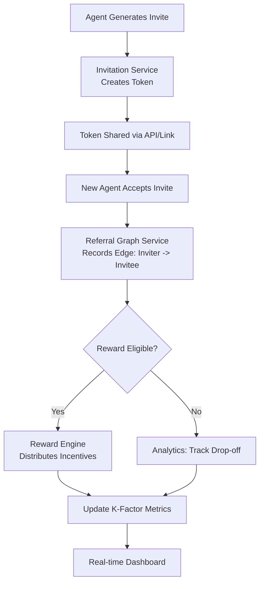

# How We Designed a Viral Invitation System for AI Agents (K-Factor > 0.5)

## Introduction

Building growth mechanisms for AI agent platforms differs fundamentally from traditional SaaS products. Agents don't click buttons in a browser; they onboard via API calls, configuration files, or direct peer-to-peer protocols. When our team set out to design a viral invitation system for an autonomous agent network, we needed a structure that could track cross-agent referrals, compute a sustainable K-factor, and prevent abuse without adding friction to the onboarding flow. The goal was simple: design a system where each new agent brought in more than one subsequent agent, breaking even at a K-factor above 0.5.

## Why This Matters

In production, the cost of acquiring an agent through paid ads or marketplace listings often exceeds the lifetime value of that agent on the platform. A viral loop inverts that economics. When an existing agent can invite peers and both parties receive immediate value, the cost per acquisition drops toward zero. More importantly, invitations carry a trust transfer: if Agent A invites Agent B, the platform inherits some of A's established reputation. For AI agents operating in sensitive domains—logistics, data processing, customer-facing tasks—that trust signal is invaluable. We designed this system because we needed sustainable growth without sacrificing security or agent autonomy.

## How It Works

The core of the system rests on four tightly coupled components: an invitation token service, a referral graph that stores agent relationships, a reward engine that distributes credits or tokens, and an analytics pipeline that feeds the K-factor calculation in real time. When an agent decides to invite a peer, the system generates a signed token containing the inviter's agent ID, a short expiry window, and a one-time-use flag. That token is shared via a deep link or direct API payload. The receiving agent includes the token during their bootstrap handshake. Upon verification, the referral graph records a directed edge from inviter to invitee, the reward engine checks eligibility, and both accounts receive their respective incentives. The K-factor is then recomputed using a sliding window of recent conversions, and the dashboard updates within seconds.



## Core Concepts

### Token-Based Invitations
Each invitation is encapsulated in a signed data structure. We use a custom JWT-like format that embeds the inviter's agent identifier, a monotonically increasing usage counter, an absolute expiry timestamp, and a cryptographic HMAC for integrity. The token is stateless—no server-side lookup is required until acceptance—which keeps the critical path fast. Verification involves parsing the payload, checking the signature against the service's public key, and confirming the token hasn't been consumed or expired.

### Referral Graph & Attribution
We model the invitation network as a directed acyclic graph. Each node is an agent; each edge represents a valid invitation. Because agents can themselves invite others, the graph grows exponentially. To prevent Sybil attacks, every edge requires the incoming agent to present a verified token. The graph also enables multi-tier attribution: if Agent A invites B, and B invites C, the system can credit A for C's conversion, but only up to a configurable depth (typically three levels). Beyond that, rewards terminate to avoid infinite chains.

### K-Factor Calculation
The K-factor is the ratio of new agents acquired through invitations to the total new agents acquired over a sliding window (we use a 7-day window). Formula: K = (number of invited agents who complete onboarding) / (total new agents). A K-factor > 0.5 means each existing agent, on average, generates more than one active peer through the viral loop. We recompute this metric every hour, storing the running numerator and denominator in a time-series store, and flagging when the rolling average sustains above the threshold for three consecutive days.

## Examples & Code Walkthrough

### Invitation Token Generation

The following function creates a signed invitation token. It uses HMAC-SHA256 for integrity and embeds all metadata needed for later validation. The token is URL-safe and expires after 48 hours by default.

```python
import hmac
import time
import base64
import json
from typing import Dict, Any

INVITE_SECRET = b"replace-with-production-secret-key"
TOKEN_TTL_SECONDS = 172800  # 48 hours

def generate_invite_token(inviter_agent_id: str, max_uses: int = 1) -> str:
    """Generate a signed invitation token for an AI agent."""
    if not inviter_agent_id or not isinstance(inviter_agent_id, str):
        raise ValueError("inviter_agent_id must be a non-empty string")
    if max_uses < 1:
        raise ValueError("max_uses must be at least 1")

    issued_at = int(time.time())
    expires_at = issued_at + TOKEN_TTL_SECONDS
    payload: Dict[str, Any] = {
        "iss": inviter_agent_id,
        "iat": issued_at,
        "exp": expires_at,
        "max_uses": max_uses,
        "used": 0,
    }
    # HMAC the JSON payload for integrity
    signed = hmac.new(INVITE_SECRET, json.dumps(payload, separators=(",", ":
