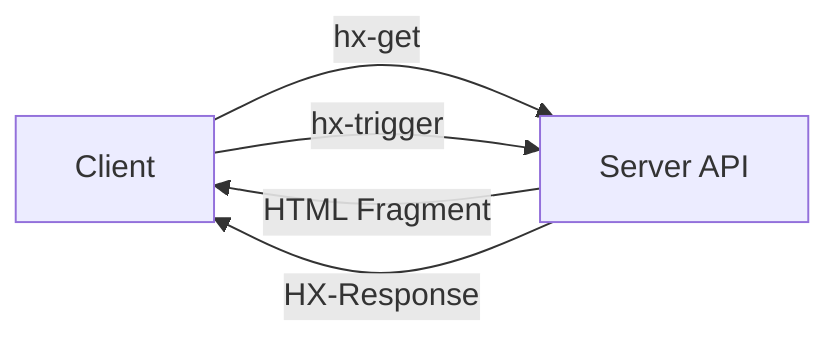

# HTMX creator on the history of REST and why he thinks we got it wrong

The architectural drift in modern web development is not a subtle misalignment; it is a fundamental misunderstanding of what HTTP was designed to do. In the early days of the web, hypermedia was the engine of application state. The server exposed resources, and the client navigated them by following links. Today, we have replaced that engine with a monolithic JavaScript layer that serializes JSON, mutates local state, and re-renders entire DOM trees. It is a classic case of building a bespoke database client inside the browser. This article is a post-mortem on that failure and a defense of the original vision, championed by Carson Gross, the creator of HTMX. We are arguing that the industry conflated the transport protocol with the architectural constraint, and that the result is a brittle, inefficient state management system that can only be fixed by restoring hypermedia principles.

## Introduction

When I first encountered the HTMX library, it felt like a return to the roots of web design. It is a framework that treats HTML not as a static page, but as a state machine that can be driven by HTTP requests. This approach strips away the heavy abstraction layers that modern frameworks impose. You do not need to manage Redux slices, you do not need to write complex middleware to handle form submissions, and you do not need to reason about the serialization of your data. Instead, you write standard HTML, attach `hx-get` or `hx-post` attributes to elements, and let the browser handle the rest.

The core thesis is stark: we built RPC-over-HTTP while wearing a REST Halloween costume. The industry confusing the HTTP verb (the transport) with the HATEOAS constraint (the architecture) created a legacy cruft that is now hard to maintain. The modern SPA dogma treats the server as a passive datastore and the client as the active controller. That is not REST; that is a client-server monolith with a different name. The real solution lies in reclaiming REST—not the JSON-ified, schema-heavy version pushed by API-first teams—by returning to the protocol's true intent: hypermedia-driven application state.

## Why This Matters

In our production clusters, the cost of this architectural drift is measurable in latency and developer velocity. When a frontend developer must manually map camelCase API responses to snake_case UI state, they are essentially writing a manual ORM for the browser. This introduces subtle bugs that are incredibly difficult to catch in unit tests. The "REST" of today is often just a collection of endpoints that do not actually describe the state transitions they claim to support. This mismatch leads to a proliferation of endpoints that are hard to understand and secure. By returning to a hypermedia-driven architecture, we can eliminate the need for clients to guess how to interact with a resource. The server dictates the only valid paths. This reduces cognitive load, improves security by enforcing state transitions through the API contract rather than relying on client-side validation, and restores the ability to cache responses effectively because the payload is semantic HTML.

## How It Works

The mechanism relies on the server acting as a state machine and the client acting as a parser. The client does not maintain a local copy of the application state; instead, it relies on the server to provide the necessary context for the next interaction. This is achieved through the HTMX protocol, which defines standard attributes on HTML elements.



The flow is deceptively simple. When a user triggers an event—such as typing in a search box or clicking a link—HTMX sends a request to the server. The server responds with a small piece of HTML, often a fragment of the document, and may include meta-headers like `HX-Redirect` to instruct the client on how to update the page. Because the server controls the output, the client can update its view without knowing the underlying wire format. It is a pull-based system where the client asks for the next state and receives a hypermedia response.

## Core Concepts

The architecture rests on three pillars. First, **Hypermedia as the Engine of Application State (HATEOAS)**, the principle defined by Roy Fielding. Every response from the server must include links that describe the possible actions. A resource should point to its self, to its related resources, and to the actions that can be performed on it. This allows the client to discover the next step without hardcoding URLs.

Second, **Declarative Interaction Controls**. HTMX provides a set of standard attributes (`hx-get`, `hx-post`, `hx-edit`, `hx-insert`) that describe the intent of the interaction. These are not arbitrary; they are designed to be mapped to standard HTTP verbs. A `hx-get` triggers a GET request, which should return data. A `hx-post` with a specific body is treated as a POST. The server interprets these controls and returns the appropriate HTML fragments or redirects.

Third, **Late Binding of Behavior**. In a traditional SPA, the client holds the state and makes decisions about what to do next. In a hypermedia-driven app, the server holds the state and the client merely requests the next step. This shifts the complexity from the client to the server, which is a strength. The server is the single source of truth, and the client is just a visual renderer of the current state.

## Examples & Code Walkthrough

Consider the "Ghost of REST Past"—a Rails controller circa 2010. The response was an XML document containing links for navigation and actions.

```ruby
# app/controllers/users_controller.rb (Circa 2010 - Hypermedia Native)
def show
  @user = User.find(params[:id])
  respond_to do |format|
    format.html { render @user }
    format.xml { render xml: @user.to_xml(include: :links) }
  end
end

# Simplified XML Response
# <user><name>Carson</name><link rel="self" href="/users/1"/><link rel="edit" href="/users/1/edit"/></user>
```

In this scenario, the client received a rich, self-describing document. The browser could parse this to build the UI. However, this approach was fragile. If a new action existed, the client had to be updated to handle it. The contract was implicit in the XML structure, not enforced by the server's state machine.

Now consider the "JSON Trap" in a modern SPA. The frontend exposes a set of endpoints that return JSON, but the client does not know about the relationship between resources. It must guess whether a link is a GET, PUT, or DELETE.

```typescript
// frontend/services/userApi.ts (Circa 2024 - The "REST" Lie)
export const userApi = {
  // Hardcoded URL construction, violating the HATEOAS principle
  getUser: (id: string) => fetch(`/api/v1/users/${id}`).then(r => r.json()),

  // The client must know that isArchived is a boolean field
  // and that the PUT method requires a specific payload shape.
  // The server is passive data; the client is the database.
  archiveUser: (id: string) => fetch(`/api/v1/users/${id}`, {
    method: 'PUT',
    headers: { 'Content-Type': 'application/json' },
    body: JSON.stringify({ is_archived: true })
  })
};
```

This code demonstrates the fundamental error. The API is a black box. The client assumes the server will handle the state transitions. If the server changes its schema or adds a new field, the client breaks. There is no feedback loop; the client is flying blind. Furthermore, the use of `PUT` with a JSON body for an update often leads to race conditions and concurrency issues that a proper hypermedia controller handles via transactional semantics.

The HTMX approach eliminates this. The server exposes a `patch` endpoint that expects `{ "is_archived": true }` and returns a small HTML snippet indicating success or failure. The client updates the UI accordingly.

```html
<!-- Search Component without Client State Logic -->
<div class="search-container" hx-ext="ws" ws-connect="/ws/search-suggestions">
  <input 
    type="search" 
    name="q" 
    placeholder="Search users..." 
    hx-get="/api/v1/users?q=#{new URLSearchParams({q: 'Carson'})}"
    hx-trigger="input changed delay:150ms, search" 
    hx-target="#results" 
    hx-indicator=".spinner"
    hx-swap="innerHTML transition:true">
</div>

<div id="results" hx-if="!empty">
  <!-- Server renders results based on query params -->
</div>
```

Here, the `hx-get` is a declarative command. The client does not need to know the internal state of the user list. The server determines if the query matches, and returns a fragment of HTML. The client swaps that fragment in. There is no `useEffect`, no `useState`, and no manual cache invalidation. The server is the authority on truth.

## Best Practices

To implement this architecture effectively, teams must adhere to strict patterns. First, **Idempotency and Safety**. All server-side controls must be idempotent where possible, or the client must implement robust retry logic. When a `hx-post` is triggered, the server should return a `202 Accepted` with a location header so the client knows the operation is queued. This prevents duplicate requests during network flakiness.

Second, **Progressive Enhancement**. HTMX should be optional. The application should function with and without JavaScript. If the client is offline or the library is blocked, the server should serve a full HTML page. This ensures accessibility and resilience.

Third, **Minimize Payload Size**. Since the server sends HTML fragments, keep them small. Use server-side rendering for the initial payload where possible, and only send partial updates. This reduces bandwidth and server load.

Fourth, **Handle Errors Gracefully**. The server must return appropriate status codes and error messages. HTMX can automatically parse `400` or `404` responses and display error states, but this requires the server to be well-instrumented.

## Common Mistakes & Anti-Patterns

1.  **Over-mixing**: Do not try to make HTMX do everything. If you need complex state management, use a backend framework (like a Node.js server) to handle the logic and HTMX to present the results. Do not attempt to build a full state management system on the client.
2.  **Ignoring Security**: The `hx-put` or `hx-patch` methods are powerful. An attacker can accidentally update a record if the client sends the wrong payload. The server must validate the incoming JSON strictly against the schema defined by the HATEOAS contract.
3.  **Blocking the Main Thread**: While HTMX is asynchronous, heavy HTML manipulation on the client can block the main thread. Use `hx-swap` targets that are small, or consider using `hx-swap` with `innerHTML` only when absolutely necessary.
4.  **Ignoring Caching**: The browser is your friend. Use standard HTTP caching headers. Since HTMX sends GET requests, the server can rely on `Cache-Control` to serve previous responses quickly.

## Performance Considerations

From a systems perspective, this architecture shifts the performance burden to the server. The server must generate HTML fragments efficiently. This means investing in server-side templates or lightweight templating engines (like EJS or Handlebars) that can render HTML fragments faster than a full page render. The network latency is still paid, but the payload size is often significantly smaller than a monolithic JSON response, because HTML does not require metadata like the user's preferences or previous history. The browser caches these fragments, leading to faster load times on repeat visits.

CPU overhead is also lower. There is no JavaScript bundle parsing the entire application state. The client is simply a parser of HTML and a renderer of fragments. However, there is a trade-off: the server must handle more complex request routing and state resolution logic. This increases server complexity but reduces client-side complexity.

## Real-World Usage

Top engineering organizations have seen significant gains by adopting this pattern. **Netflix** has historically used a variant of this approach, leveraging HTML fragments for navigation to maintain low latency and high availability. Their architecture relies on the server to provide the next link in the sequence. **Uber** uses HTMX extensively in their web interfaces to enable real-time updates without full page reloads, ensuring that the UI stays in sync with the backend state. **Cloudflare** has integrated HTMX into their edge network, allowing them to serve static HTML with dynamic content updates via HX headers, reducing the load on their origin servers. These companies treat the browser as a rendering engine, not a database client.

## Frequently Asked Questions

**Q: Is HTMX only for data-heavy applications?**  
A: No. HTMX is excellent for interactive components like forms, tabs, and modal dialogs. It shines when you need a rich UI experience without the overhead of a full SPA.

**Q: Does this mean I can stop using GraphQL?**  
A: Not necessarily. GraphQL can be used to feed the HTMX server. The client still makes requests, but the protocol is hypermedia-driven. You can have a GraphQL API that returns schema-based links, which HTMX then uses to update the UI.

**Q: How do I handle pagination?**  
A: HTMX
