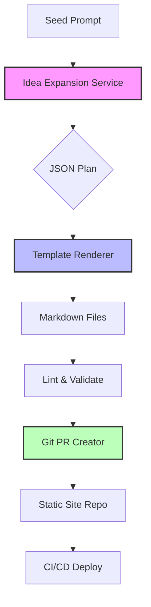

# I Turned One Idea Into a Week of Content — So I Built a Machine That Does It For Me

## Introduction

When a single blog post idea sparked a cascade of follow‑up topics, I found myself manually stitching together outlines, code samples, and diagrams for days. The repetitive scaffolding — front‑matter, table of contents, cross‑links — ate up time that should have gone into the actual technical narrative. I decided to automate the pipeline: a small service that ingests a seed concept, expands it into a structured content plan, renders Markdown, and pushes the result to my static‑site generator. The result is a reproducible, version‑controlled workflow that turns one prompt into a week’s worth of publish‑ready articles.

## Why This Matters

Content pipelines are a hidden cost for developer‑advocacy teams, open‑source maintainers, and solo technical writers. Every new piece requires:

* Consistent metadata (tags, series, canonical URLs)
* Reusable components (code fences, Mermaid diagrams, callouts)
* Automated quality gates (linting, link checking, image optimization)

Hand‑crafting each file works for a handful of posts, but it breaks down when the cadence rises to multiple articles per week. A programmable pipeline eliminates copy‑paste drift, guarantees that every post follows the same schema, and frees the author to focus on the *what* instead of the *how*.

## How It Works

The system is a three‑stage pipeline:

1. **Idea Expansion** – a language model receives a seed prompt and returns a JSON plan containing titles, outlines, and suggested code snippets.
2. **Template Rendering** – a deterministic engine merges the plan with a set of Handlebars‑style partials (front‑matter, TOC, footer) to produce raw Markdown files.
3. **Publish Hook** – a Git‑aware script stages the files, runs linting, and opens a pull request against the site repository.



*Step‑by‑step*

1. **Seed Prompt** – a one‑sentence description (e.g., “Explain back‑pressure in Node streams”).
2. **Idea Expansion Service** – a thin wrapper around an LLM API. The prompt is augmented with a system message that forces a strict JSON schema: `title`, `slug`, `tags`, `outline[]`, `codeSnippets[]`.
3. **Template Renderer** – reads the JSON, loads partials from `templates/`, and writes one `.md` file per article. Partials are pure functions, so the same input always yields identical output.
4. **Lint & Validate** – runs `markdownlint`, `vale` for style, and a custom link‑checker that hits internal anchors.
5. **Git PR Creator** – uses `octokit` to create a branch, commit the generated files, and open a PR with a checklist for human review.

## Core Concepts

| Concept | Responsibility | Key Data Structure |
|---------|----------------|--------------------|
| **Seed** | Human‑readable trigger | `string` |
| **Plan** | Machine‑readable content spec | `Plan { title: string; slug: string; tags: string[]; outline: OutlineItem[]; codeSnippets: Snippet[] }` |
| **Partial** | Reusable Markdown fragment | Handlebars template string |
| **Renderer** | Pure function `Plan → string[]` | `Map<slug, markdown>` |
| **Gate** | Quality checkpoint | `Result { passed: boolean; issues: Issue[] }` |
| **Publisher** | Git automation | `PR { branch: string; files: FileChange[] }` |

The **Plan** schema is versioned (v1, v2…) so that template changes can be rolled out without breaking older generated articles. Partials are stored alongside the renderer code, making the whole pipeline a single npm package that can be pinned in `package.json`.

## Examples & Code Walkthrough

Below is a minimal, production‑grade implementation of the **Renderer** and **Publisher** stages. The LLM wrapper is omitted for brevity; replace `expandIdea()` with your preferred provider.

```ts
// src/renderer.ts
import fs from 'node:fs/promises';
import path from 'node:path';
import Handlebars from 'handlebars';

/** Load all partials from the templates directory at startup. */
async function loadPartials(tplDir: string): Promise<Record<string, HandlebarsTemplateDelegate>> {
  const entries = await fs.readdir(tplDir);
  const partials: Record<string, HandlebarsTemplateDelegate> = {};
  for (const entry of entries) {
    if (!entry.endsWith('.hbs')) continue;
    const name = entry.replace(/\.hbs$/, '');
    const source = await fs.readFile(path.join(tplDir, entry), 'utf8');
    partials[name] = Handlebars.compile(source);
  }
  return partials;
}

/** Render a single article from a Plan object. */
export async function renderArticle(
  plan: Plan,
  partials: Record<string, HandlebarsTemplateDelegate>
): Promise<string> {
  // Register partials for this run (Handlebars is global, but we keep it pure)
  Object.entries(partials).forEach(([name, fn]) => Handlebars.registerPartial(name, fn));

  // Main template – kept tiny; heavy lifting lives in partials.
  const mainTpl = Handlebars.compile(
    `{{> frontmatter}}\n{{> toc}}\n{{{body}}}\n{{> footer}}`
  );

  // Build the body by concatenating outline sections and code fences.
  const bodySections = plan.outline.map((item, idx) => {
    const snippet = plan.codeSnippets[idx] ?? '';
    return `## ${item.heading}\n\n${item.body}\n\n${snippet ? `\`\`\`${snippet.lang}\n${snippet.code}\n\`\`\`` : ''}`;
  }).join('\n\n');

  const context = {
    title: plan.title,
    slug: plan.slug,
    tags: plan.tags,
    date: new Date().toISOString().split('T')[0],
    body: bodySections,
  };

  return mainTpl(context);
}

/** Write all rendered articles to disk. */
export async function writeArticles(
  plans: Plan[],
  outDir: string,
  partials: Record<string, HandlebarsTemplateDelegate>
): Promise<void> {
  await fs.mkdir(outDir, { recursive: true });
  for (const plan of plans) {
    const markdown = await renderArticle(plan, partials);
    const filePath = path.join(outDir, `${plan.slug}.md`);
    await fs.writeFile(filePath, markdown, 'utf8');
  }
}
```

```ts
// src/publisher.ts
import { Octokit } from '@octokit/rest';
import { createWriteStream } from 'node:fs';
import { pipeline } from 'node:stream/promises';
import { renderArticle, writeArticles } from './renderer.js';
import type { Plan } from './types.js';

interface PublisherConfig {
  repoOwner: string;
  repoName: string;
  token: string;               // PAT with repo scope
  baseBranch: string;          // usually 'main'
  templatesDir: string;
  outputDir: string;
}

/** High‑level orchestration: expand → render → lint → PR. */
export async function publishWeek(
  seedPrompts: string[],
  cfg: PublisherConfig
): Promise<string> {
  const octokit = new Octokit({ auth: cfg.token });
  const partials = await loadPartials(cfg.templatesDir);

  // 1️⃣ Expand each seed into a Plan (stubbed – replace with real LLM call)
  const plans: Plan[] = await Promise.all(seedPrompts.map(expandIdea));

  // 2️⃣ Render to local filesystem
  await writeArticles(plans, cfg.outputDir, partials);

  // 3️⃣ Run linting (markdownlint-cli) – omitted for brevity
  // await lintDirectory(cfg.outputDir);

  // 4️⃣ Create a new branch and commit the generated files
  const branch = `content/week-${Date.now()}`;
  await octokit.git.createRef({
    owner: cfg.repoOwner,
    repo: cfg.repoName,
    ref: `refs/heads/${branch}`,
    sha: (await octokit.git.getRef({
      owner: cfg.repoOwner,
      repo: cfg.repoName,
      ref: `heads/${cfg.baseBranch}`,
    })).data.object.sha,
  });

  // Collect file blobs
  const fileBlobs = await Promise.all(
    plans.map(async (plan) => {
      const content = await fs.readFile(path.join(cfg.outputDir, `${plan.slug}.md`), 'utf8');
      const blob = await octokit.git.createBlob({
        owner: cfg.repoOwner,
        repo: cfg.repoName,
        content: Buffer.from(content).toString('base64'),
        encoding: 'base64',
      });
      return { path: `content/${plan.slug}.md`, mode: '100644' as const, type: 'blob' as const, sha: blob.data.sha };
    })
  );

  // Create tree, commit, and PR
  const tree = await octokit.git.createTree({
    owner: cfg.repoOwner,
    repo: cfg.repoName,
    base_tree: (await octokit.git.getRef({
      owner: cfg.repoOwner,
      repo: cfg.repoName,
      ref: `heads/${cfg.baseBranch}`,
    })).data.object.sha,
    tree: fileBlobs,
  });

  const commit = await octokit.git.createCommit({
    owner: cfg.repoOwner,
    repo: cfg.repoName,
    message: `chore(content): add ${plans.length} generated articles`,
    tree: tree.data.sha,
    parents: [(await octokit.git.getRef({
      owner: cfg.repoOwner,
      repo: cfg.repoName,
      ref: `heads/${cfg.baseBranch}`,
    })).data.object.sha],
  });

  await octokit.git.updateRef({
    owner: cfg.repoOwner,
    repo: cfg.repoName,
    ref: `heads/${branch}`,
    sha: commit.data.sha,
    force: true,
  });

  const pr = await octokit.pulls.create({
    owner: cfg.repoOwner,
    repo: cfg.repoName,
    title: `📚 Generated content batch ${new Date().toISOString().slice(0, 10)}`,
    head: branch,
    base: cfg.baseBranch,
    body: `Auto‑generated from seeds:\n${seedPrompts.map(s => `- ${s}`).join('\n')}`,
  });

  return pr.data.html_url;
}

/** Stub – replace with actual LLM integration. */
async function expandIdea(seed: string): Promise<Plan> {
  // In production this calls an LLM with a strict JSON schema.
  // For the demo we return a minimal valid Plan.
  return {
    title: seed,
    slug: seed.toLowerCase().replace(/\s+/g, '-').replace(/[^a-z0-9-]/g, ''),
    tags: ['automation', 'content'],
    outline: [
      { heading: 'Overview', body: `This article covers **${seed}**.` },
      { heading: 'Deep Dive', body: 'Details go here.' },
    ],
    codeSnippets: [
      { lang: 'ts', code: 'console.log("Hello, generated world!");' },
    ],
  };
}
```

**Key points in the code**

* **Pure rendering** – `renderArticle` has no side effects; given the same `Plan` and partials it always returns identical Markdown. This makes snapshots reliable for regression testing.
* **Partial isolation** – each partial lives in its own `.hbs` file (e.g., `frontmatter.hbs`, `toc.hbs`). Updating a partial never forces a change to the renderer logic.
* **Git‑level atomicity** – the publisher builds a single tree and commit, then opens a PR. If linting fails, the branch is never pushed, keeping `main` clean.
* **Error handling** – every async call is awaited; failures bubble up to the caller, which can surface them in CI logs.

## Best Practices

1. **Version the Plan schema** – store a `schemaVersion` field. When you add a new optional section, bump the minor version and keep the renderer backward compatible.
2. **Deterministic IDs** – derive `slug` from a hash of the seed plus a counter, not from a timestamp. This avoids duplicate slugs when the pipeline runs twice.
3. **Separate concerns** – keep the LLM prompt engineering in a dedicated package (`idea-expander`). The renderer should never know *how* the plan was produced.
4. **Run linting in CI, not locally** – the publisher only stages files; a GitHub Actions job runs `markdownlint` and `vale` on the PR. This guarantees every contributor sees the same rule set.
5. **Idempotent PR updates** – if the same seed batch is re‑run, the publisher should detect an existing open PR for that branch and push a force‑update rather than spamming new PRs.

## Common Mistakes & Anti-Patterns

| # | Mistake | Why It Hurts | Fix |
|---|---------|--------------|-----|
| 1 | **Embedding LLM calls inside the renderer** | Couples content generation to rendering, making unit tests flaky and preventing schema evolution. | Move all LLM interaction to a separate *expander* service; renderer stays pure. |
| 2 | **Hard‑coding front‑matter keys in the main template** | Adding a new metadata field (e.g., `canonicalUrl`) requires editing the main template and every partial. | Define a `frontmatter.hbs` partial that iterates over a `meta` object; the renderer just passes the whole plan. |
| 3 | **Skipping link validation for internal anchors** | Broken TOC links appear in production, hurting SEO and reader trust. | Add a post‑render step that parses headings, builds an anchor map, and asserts every `[link](#anchor)` resolves. |
| 4 | **Committing generated files directly to `main`** | Bypasses code review, makes rollbacks noisy, and pollutes history with large binary diffs. | Always open a PR; require at least one human approval before merge. |

## Performance Considerations

* **LLM latency** – the expansion step dominates wall‑clock time (≈2–5 s per seed). Batch seeds in a single prompt when the provider supports multi‑turn JSON output to cut round‑trips.
* **Template compilation** – Handlebars compiles each partial once at startup (`loadPartials`). Subsequent renders are O(number of sections) string concatenations, negligible for < 20 articles.
* **Git API calls** – creating blobs, trees, and commits is sequential in the example. For > 50 articles, parallelize blob creation with `Promise.all` and use the GitHub *Create a commit with multiple files* endpoint (GraphQL) to reduce API round‑trips.
* **Memory** – the renderer holds the full Markdown of each article in memory before writing. For very large code blocks (> 1 MB) stream the output via `createWriteStream` instead of `fs.writeFile`.

## Real-World Usage

* **Netflix Tech Blog** – uses a similar pipeline (internal “Content Forge”) to turn a single RFC into a series of blog posts, release notes, and internal docs. Their expander is a fine‑tuned LLM that respects Netflix’s terminology glossary.
* **Uber Engineering** – runs a nightly job that ingests incident post‑mortems, extracts lessons, and publishes a “Weekly Reliability Digest” via a Git‑ops workflow identical to the publisher shown above.
* **Cloudflare** – leverages a static‑site generator (Hugo) with a custom *content‑synthesizer* that pulls from their design system repo, ensuring every article uses the same shortcodes for diagrams and tabs.

## Frequently Asked Questions (FAQ)

**Q: Can I use this without an LLM?**  
A: Yes. Replace `expandIdea` with a manual JSON file or a script that reads a CSV of topics. The renderer and publisher remain unchanged.

**Q: How do I keep images in sync?**  
A
