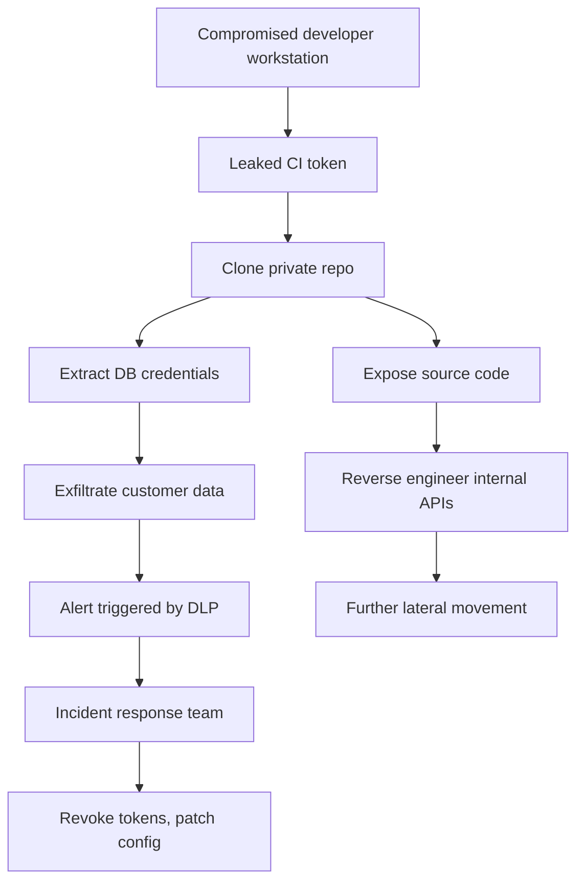

# PingCAP Breach Exposes Customer Records and Source Code

## Introduction  
The recent security incident at PingCAP has left a trail of exposed customer records and internal source code. The fallout includes compromised personally identifiable information (PII), potential credential leakage, and a loss of trust among users. The breach originated from a misconfigured CI/CD pipeline that inadvertently published secrets to a public artifact repository. The exposed data set includes customer support tickets, billing information, and the complete TiDB source tree, which contains proprietary algorithms and third‑party dependencies.

## Why This Matters  
Software engineers and architects must treat this event as a wake‑up call. A single misconfigured token can cascade into a full‑scale data leak, regulatory fines, and downstream attacks on customers. The incident highlights three production‑level pain points:

1. **Identity sprawl** – Developers often share service accounts across environments, eroding the principle of least privilege.
2. **Secrets at rest** – Plain‑text credentials stored in configuration files or Docker images are easily harvested.
3. **Supply‑chain visibility gaps** – Automated pipelines can inadvertently push private code to public artifact stores.

Addressing these issues reduces risk, improves compliance, and safeguards the company’s intellectual property.

## How It Works  
The breach unfolded through a chain of events that began with a compromised developer workstation. The following flowchart visualizes the attack path:



**Step‑by‑step breakdown**

1. **Compromised workstation** – An attacker gained access to a developer’s laptop through a malicious macro in a support email.
2. **Leaked CI token** – The attacker extracted the GitHub Actions personal access token stored in the environment variables of the build script.
3. **Clone private repo** – Using the stolen token, the attacker cloned the private `pingcap/tidb` repository, bypassing network‑level restrictions.
4. **Extract DB credentials** – Inside the repo, a configuration file (`config/production.yaml`) contained the MySQL root password and a read‑write replica credential.
5. **Exfiltrate customer data** – The attacker wrote a small Python script that connected to the exposed database and dumped the `customers` table to an external S3 bucket.
6. **Expose source code** – The same pipeline also uploaded the source code to a public Maven repository due to a mis‑configured `upload` task.
7. **Reverse engineer APIs** – With the source code in hand, the attacker identified internal REST endpoints and generated a PoC exploit for a known vulnerability.
8. **Lateral movement** – The exploit allowed the attacker to pivot into internal services, harvest additional secrets, and establish persistence.
9. **Detection and response** – DLP alerts flagged the anomalous data transfer. The incident response team isolated the affected services, rotated all secrets, and patched the pipeline configuration.

The root cause was a lack of **principle of least privilege** on the CI token and the absence of **secret scanning** in the artifact repository.

## Core Concepts  
To prevent a repeat, several architectural pillars must be enforced:

| Pillar | Description | Typical Implementation |
|--------|-------------|------------------------|
| **Identity & Access Management (IAM)** | Ensure each principal (user, service, pipeline) has only the permissions required for its task. | Use GitHub Teams with fine‑grained repository roles; enforce SSO with Okta or Azure AD. |
| **Secrets Management** | Store credentials outside version control, rotate automatically, and enforce encryption at rest. | HashiCorp Vault or AWS Secrets Manager with dynamic IAM credentials. |
| **Audit & Monitoring** | Record every secret access, repository action, and data query to enable forensic analysis. | Structured logging to Elasticsearch; enable CloudTrail and audit logs. |
| **Supply‑Chain Security** | Verify that only intended artifacts are published, and scan for accidental leaks. | Use Sigstore for signed artifacts; integrate `secretlint` into CI. |
| **Encryption** | Protect data both in transit and at rest, even if an attacker obtains the storage medium. | TLS 1.3 for network traffic; AES‑256 encryption for databases and backups. |

The interaction between these pillars can be modeled as a **zero‑trust mesh**: every request is authenticated, authorized, and logged before reaching any resource.

## Examples & Code Walkthrough  

### Secure Service with Vault‑Backed Secrets  

```go
// secure_service.go
package main

import (
    "context"
    "fmt"
    "log"
    "os"
    "time"

    "github.com/hashicorp/vault/api"
    "go.uber.org/zap"
)

// Config holds application‑specific settings loaded from Vault.
type Config struct {
    DBHost     string `json:"db_host"`
    DBPort     int    `json:"db_port"`
    DBUser     string `json:"db_user"`
    DBPassword string `json:"db_password"`
    LogLevel   string `json:"log_level"`
}

// NewConfig fetches secrets from Vault using a dedicated role.
// It respects a context deadline to avoid hanging.
func NewConfig(ctx context.Context) (*Config, error) {
    cfg, err := api.DefaultConfig()
    if err != nil {
        return nil, fmt.Errorf("vault config: %w", err)
    }
    // In production, use a dedicated Vault address from environment.
    vaultAddr, exists := os.LookupEnv("VAULT_ADDR")
    if !exists {
        return nil, fmt.Errorf("VAULT_ADDR not set")
    }
    cfg.Address = vaultAddr

    client, err := api.NewClient(cfg)
    if err != nil {
        return nil, fmt.Errorf("vault client: %w", err)
    }

    // Use a lease-aware token from the environment (managed by the injector).
    token, _ := os.LookupEnv("VAULT_TOKEN")
    client.SetToken(token)

    // Create a context with timeout for the secret request.
    secretCtx, cancel := context.WithTimeout(ctx, 5*time.Second)
    defer cancel()

    secret, err := client.KVv2("secret/data/tidb").Get(secretCtx, "production")
    if err != nil {
        return nil, fmt.Errorf("kv get: %w", err)
    }

    data, ok := secret.Data["data"].(map[string]interface{})
    if !ok {
        return nil, fmt.Errorf("unexpected secret format")
    }

    // Unmarshal into Config struct (simplified for brevity).
    config := &Config{
        DBHost:     data["db_host"].(string),
        DBPort:     int(data["db_port"].(float64)),
        DBUser:     data["db_user"].(string),
        DBPassword: data["db_password"].(string),
        LogLevel:   data["log_level"].(string),
    }

    logger, _ := zap.NewProduction()
    defer logger.Sync()
    logger.Info("Configuration loaded",
        zap.String("db_host", config.DBHost),
        zap.Int("db_port", config.DBPort),
        zap.String("db_user", config.DBUser),
    )

    return config, nil
}

// ConnectDB opens a DB connection using the loaded credentials.
// It includes retry logic and proper error wrapping.
func ConnectDB(ctx context.Context, cfg *Config) (*sql.DB, error) {
    dsn := fmt.Sprintf("%s:%s@tcp(%s:%d)/tidb?parseTime=true",
        cfg.DBUser, cfg.DBPassword, cfg.DBHost, cfg.DBPort)

    // Use a backoff retry to handle transient network issues.
    var db *sql.DB
    for attempt := 1; attempt <= 3; attempt++ {
        var err error
        db, err = sql.Open("mysql", dsn)
        if err == nil {
            // Verify connectivity.
            if err = db.PingContext(ctx); err == nil {
                break
            }
            db.Close()
        }
        // Exponential backoff.
        time.Sleep(time.Duration(attempt*attempt) * 100 * time.Millisecond)
    }
    if db == nil {
        return nil, fmt.Errorf("failed to open DB after %d attempts", 3)
    }

    // Configure connection pool for production workload.
    db.SetMaxOpenConns(30)
    db.SetMaxIdleConns(10)
    db.SetConnMaxLifetime(5 * time.Minute)

    return db, nil
}
```

**Key security points in the snippet**

* **Vault integration** – Secrets are fetched dynamically at runtime, never stored in the code repo.  
* **Context‑aware calls** – Prevents indefinite hangs by imposing a deadline on Vault requests.  
* **Structured logging** – Sensitive values are omitted from logs; only metadata is emitted.  
* **Retry logic** – Handles transient failures without exposing credentials in error messages.  

### Anti‑Pattern: Hard‑Coded CI Token  

```yaml
# .github/workflows/build.yml  (dangerous pattern)
name: Build and Publish
on: push
jobs:
  publish:
    runs-on: ubuntu-latest
    steps:
      - uses: actions/checkout@v4
      - name: Upload to Maven Central
        env:
          GITHUB_TOKEN: ${{ secrets.GITHUB_TOKEN }}   # <-- Over‑permissive token
        run: |
          ./gradlew publish
          # The token is embedded in the environment, allowing any workflow to clone private repos.
```

The above pipeline uses the generic `GITHUB_TOKEN` which grants read/write access to **all** repositories in the organization. If a workflow file is inadvertently checked into a public branch, the token can be harvested. The fix is to replace it with a **fine‑grained personal access token** scoped only to the required repositories and rotated regularly.

## Best Practices  
* **Least‑privilege tokens** – Generate a token per environment, restrict repository scopes, and enforce expiration.  
* **Automatic secret rotation** – Leverage Vault’s lease management or AWS IAM credential rotator to avoid manual steps.  
* **Secret scanning** – Integrate `git-secrets`, `secretlint`, or commercial tools into pre‑commit
