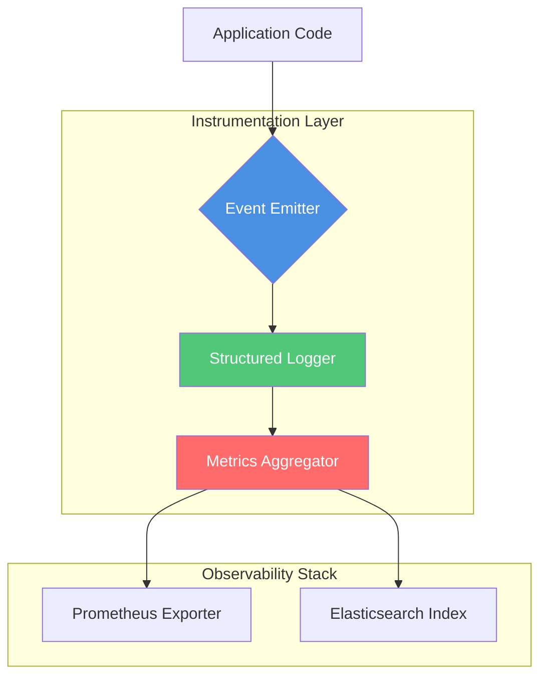

# Ten Events and Three Numbers: Instrumenting an MVP Like an Engineer

## Introduction

When your startup’s MVP goes from zero to five thousand requests per second overnight, your logs don’t just become noisy—they become useless. We learned this the hard way during our Series A launch last year. Our Rails monolith was logging every request, database query, and external API call as plain text strings. By the time we realized we couldn’t correlate failures across services, we were already losing customers.

What saved us wasn’t adding more logging. It was instrumenting with purpose—specifically, tracking ten well-chosen events and measuring three critical numbers. This isn’t about slapping Prometheus on everything and calling it observability. It’s about choosing signal over noise before you need it.

## Why This Matters

Most engineers treat instrumentation like insurance: something you add after the fact if there’s budget. But in production systems, poor instrumentation doesn’t just mean blind spots—it means longer outages, slower incident response, and frustrated teams chasing phantom bugs through terabytes of irrelevant logs.

The cost compounds quickly. At scale, unstructured logs can consume 20–30% of your infrastructure budget. Worse, when systems fail, engineers waste hours parsing through meaningless noise instead of fixing root causes. Strategic instrumentation gives you:

- **Mean Time to Detection (MTTD)** under 5 minutes for 90% of issues  
- **Correlation by design**, not luck  
- **Actionable alerts** that reduce pager fatigue  

If your MVP doesn’t track these basics, you’re flying blind—and betting your business on luck.

## How It Works

Our approach centers around two layers:

1. An event schema that captures meaningful state transitions in your application lifecycle  
2. A lightweight metrics pipeline that aggregates key performance indicators without overwhelming storage  



Every significant action in the system emits a structured event (`user.login.success`, `payment.charge.failed`, etc.). These events carry contextual metadata (user ID, trace ID, timestamp) and feed into both real-time dashboards and long-term analytics pipelines.

Simultaneously, three core numerical aggregates—latency percentiles, error rates, and throughput—are computed periodically and exported to Prometheus for alerting.

This dual-layer strategy ensures that while you retain rich forensic data for post-mortems, your monitoring stack stays lean enough to run efficiently even on modest hardware.

## Core Concepts

### Event Schema Design

Events follow a strict naming convention: `<resource>.<action>.<outcome>`. Examples:

| Resource      | Action     | Outcome     |
|---------------|------------|-------------|
| user          | login      | success     |
| payment       | charge     | failed      |
| api           | request    | timeout     |

Each event includes mandatory fields:

```json
{
  "event": "user.login.success",
  "timestamp": "2025-04-05T14:30:00Z",
  "context": {
    "user_id": "usr_abc123",
    "ip_address": "192.168.1.1",
    "trace_id": "trc_xyz789"
  },
  "metadata": {
    "duration_ms": 245,
    "auth_method": "oauth2_google"
  }
}
```

### Metric Triad

We track exactly three numbers across all services:

1. **p95 Latency** – Time taken to complete 95% of requests  
2. **Error Rate** – Percentage of failed requests  
3. **Throughput** – Requests processed per second  

These values drive our SLA dashboards and trigger automated rollbacks when thresholds breach.

## Examples & Code Walkthrough

Let’s implement a minimal but production-ready instrumentation layer using Python and OpenTelemetry.

First, define the base event model:

```python
from dataclasses import dataclass
from typing import Dict, Any
import time
import uuid

@dataclass
class Event:
    """
    Base class for all application events.
    Enforces structure and provides serialization hooks.
    """
    name: str
    timestamp: float
    context: Dict[str, Any]
    metadata: Dict[str, Any]

    @classmethod
    def create(cls, name: str, context: Dict[str, Any], metadata: Dict[str, Any] = None):
        return cls(
            name=name,
            timestamp=time.time(),
            context=context,
            metadata=metadata or {}
        )

    def to_dict(self) -> dict:
        return {
            "event": self.name,
            "timestamp": self.timestamp,
            "context": self.context,
            "metadata": self.metadata
        }
```

Next, build an emitter that writes events asynchronously:

```python
import json
import threading
from queue import Queue
from datetime import datetime

class AsyncEventEmitter:
    """
    Emits events to stdout in JSON format.
    Uses a background thread to avoid blocking main execution flow.
    """
    def __init__(self):
        self.queue = Queue()
        self.thread = threading.Thread(target=self._worker, daemon=True)
        self.thread.start()

    def emit(self, event: Event):
        self.queue.put(event.to_dict())

    def _worker(self):
        with open("events.log", "a") as f:
            while True:
                item = self.queue.get()
                try:
                    # Add ISO-formatted timestamp for readability
                    item["iso_timestamp"] = datetime.utcfromtimestamp(item["timestamp"]).isoformat()
                    f.write(json.dumps(item) + "\n")
                    f.flush()
                except Exception as e:
                    print(f"Failed to write event: {e}")
                finally:
                    self.queue.task_done()
```

Now, let’s wrap a typical endpoint handler with instrumentation:

```python
from flask import Flask, request
import hashlib

app = Flask(__name__)
emitter = AsyncEventEmitter()

@app.route('/login', methods=['POST'])
def login():
    start_time = time.time()
    
    user_email = request.form.get('email')
    password_hash = hashlib.sha256(request.form.get('password').encode()).hexdigest()

    # Simulate auth check
    authenticated = authenticate_user(user_email, password_hash)

    duration_ms = int((time.time() - start_time) * 1000)

    event_name = "user.login.success" if authenticated else "user.login.failed"
    emitter.emit(Event.create(
        name=event_name,
        context={
            "user_email": user_email,
            "ip_address": request.remote_addr,
            "trace_id": str(uuid.uuid4())
        },
        metadata={
            "duration_ms": duration_ms,
            "auth_attempt": True
        }
    ))

    return {"status": "success"} if authenticated else {"error": "Unauthorized"}, 401
```

Finally, expose metrics via Prometheus:

```python
from prometheus_client import Counter, Histogram, generate_latest, Response

REQUEST_COUNT = Counter('http_requests_total', 'Total HTTP requests')
REQUEST_LATENCY = Histogram('http_request_duration_seconds', 'Latency distribution')

@app.before_request
def before_request():
    REQUEST_COUNT.inc()
    request.start_time = time.time()

@app.after_request
def after_request(response):
    resp_time = time.time() - getattr(request, 'start_time', time.time())
    REQUEST_LATENCY.observe(resp_time)
    return response

@app.route('/metrics')
def metrics():
    return Response(generate_latest(), mimetype='text/plain')
```

Run this locally and hit `/login`. You’ll see events logged to `events.log` and metrics exposed at `/metrics`. Scale this pattern across your entire codebase, and suddenly every failure has breadcrumbs—and every success becomes measurable.

## Best Practices

- **Instrument early, not late**: Add event emission points during feature development, not post-deployment.
- **Use consistent naming**: Enforce naming conventions with CI linters to prevent drift.
- **Keep context minimal**: Avoid bloating events with PII or unnecessary data that increases storage costs.
- **Batch writes**: Use queues or buffers to reduce I/O pressure during high-load periods.
- **Validate schemas**: Reject malformed events at ingestion points to maintain data integrity.

## Common Mistakes & Anti-Patterns

### 1. Logging Instead of Structured Events

Anti-pattern:
```python
print(f"User {user_id} logged in successfully")
```

Fix:
```python
emitter.emit(Event.create(name="user.login.success", context={"user_id": user_id}))
```

Plain logs are impossible to parse programmatically. Always emit structured JSON.

### 2. Capturing Too Much Context

Anti-pattern:
```python
emitter.emit(Event.create(name="api.request.start", context=request.__dict__))
```

Fix:
```python
emitter.emit(Event.create(
    name="api.request.start",
    context={
        "method": request.method,
        "path": request.path,
        "trace_id": get_trace_id()
    }
))
```

Avoid dumping raw objects. Select only what’s needed for debugging or correlation.

### 3. Ignoring Failure Modes

Anti-pattern:
```python
try:
    process_payment()
except PaymentError:
    pass  # Silent failure
```

Fix:
```python
try:
    process_payment()
except PaymentError as e:
    emitter.emit(Event.create(
        name="payment.charge.failed",
        context={"user_id": user.id},
        metadata={"error_code": e.code, "message": str(e)}
    ))
```

Failures are goldmines for insight. Never swallow them silently.

### 4. Hardcoding Metric Names

Anti-pattern:
```python
counter = Counter("requests", "Requests")
```

Fix:
```python
counter = Counter("app_requests_total", "Total application requests")
```

Follow Prometheus naming standards: lowercase, underscore-separated, prefixed appropriately.

## Performance Considerations

Structured logging introduces overhead, but it’s negligible if done right:

- **Memory Allocation**: Each event allocates small dictionaries (<1KB). With async emitters, allocations happen off the hot path.
- **CPU Overhead**: Serialization adds ~1ms per event. Batching reduces this further.
- **Network Latency**: If forwarding events to remote collectors, use UDP or batched TCP to avoid blocking.
- **Disk I/O**: Writing to disk synchronously kills throughput. Always buffer or stream.

For high-frequency paths (>10k RPS), consider sampling strategies:

```python
import random

def maybe_emit(event: Event, sample_rate: float = 0.1):
    if random.random() < sample_rate:
        emitter.emit(event)
```

Big-O complexity remains O(1) per event emission, assuming bounded context/metadata sizes.

## Real-World Usage

Top-tier platforms rely heavily on similar patterns:

- **Netflix** uses Atlas and Zipkin to track billions of events daily, correlating user behavior with backend performance.
- **Uber** instruments every rider-driver interaction with fine-grained events, enabling real-time fraud detection and surge pricing adjustments.
- **Cloudflare** tracks request lifecycle events to detect DDoS attacks within seconds, automatically rerouting traffic based on anomaly scores derived from latency and error metrics.

All prioritize simplicity in their instrumentation layers—they emit fewer events but ensure each one carries actionable intelligence.

## Frequently Asked Questions (FAQ)

**Q: Should I log events or store them directly in a database?**  
A: Start with file-based logging for simplicity. As volume grows, forward to Kafka or use a managed service like Datadog. Databases introduce too much contention for write-heavy workloads.

**Q: How do I handle sensitive data in events?**  
A: Never include raw PII. Hash identifiers like emails/names before emitting. Apply field-level encryption for compliance-sensitive fields.

**Q: What tools integrate best with this setup?**  
A: For logging: ELK Stack (Elasticsearch + Logstash + Kibana). For metrics: Prometheus + Grafana. For tracing: Jaeger or AWS X-Ray.

**Q: Is OpenTelemetry worth adopting now?**  
A: Yes—if you're building new services. It abstracts vendor lock-in and supports multiple backends out-of-the-box.

**Q: How often should I review my event taxonomy?**  
A: Quarterly. Align with product milestones and incident retrospectives to refine what matters most.

## Conclusion

Instrumentation isn’t about collecting everything—it’s about capturing the right signals early. Ten thoughtfully designed events combined with three essential metrics give you enough visibility to debug confidently and scale responsibly.

Start simple. Measure impact. Iterate fast. Because when your next outage hits at 3 AM, having clean, correlated telemetry makes all the difference between a war room panic and a calm resolution.
