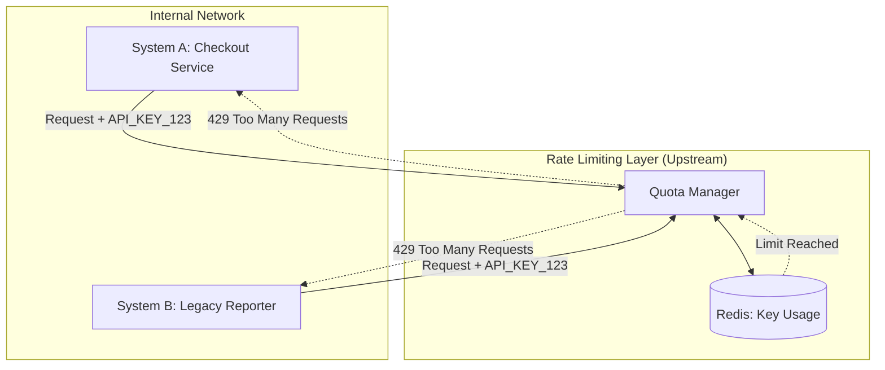

# Two systems hit the same usage limit. Only one of them was spending it.

## Introduction
Last quarter, our SRE team woke up to a critical alert: our primary payment gateway API key had hit its hourly rate limit. The immediate assumption was a traffic spike or a DDoS attack. However, the telemetry was baffling. System A (our new checkout microservice) was hammering the API with legitimate traffic. System B (a legacy reporting tool) was triggering "Rate Limit Exceeded" errors in its logs, but its own outbound request metrics were flatlined at zero.

System B was being throttled for a budget it wasn't even spending.

This is the "Phantom Usage" problem. It happens when the identity management or quota-tracking layer of a distributed system decouples the *entity* being limited from the *process* consuming the resource.

## Why This Matters
In a microservices architecture, we often group services under a single API key or organizational quota to simplify billing and management. While this seems pragmatic, it creates a hidden shared-fate dependency.

If your rate-limiting logic is centralized (e.g., in a Redis-backed global counter) but your observability is decentralized (per-service logs), you create a blind spot. When a quota is exhausted, every service sharing that identity fails. If you rely solely on local service logs to find the "culprit," you'll waste hours debugging a healthy system that is simply a victim of a noisy neighbor.

## How It Works
The root of the problem usually lies in the Shared Identity Pattern. When System A and System B share a single `API_KEY`, the upstream provider tracks usage against the key, not the source IP or the specific client ID.



1. **Request Ingress**: Both systems send requests using the same credential.
2. **Global Counting**: The upstream provider increments a single counter in their data store associated with `API_KEY_123`.
3. **Threshold Breach**: System A's high volume pushes the counter past the 1,000 req/hr limit.
4. **Indiscriminate Rejection**: The provider returns a `429 Too Many Requests` to any request carrying that key, regardless of which system sent it.
5. **The Illusion**: System B's logs show failures, but its internal "successful requests" metric remains zero because it never actually got to "spend" its portion of the quota.

## Core Concepts
To solve this, we have to understand three distinct types of limiting:

*   **Hard Limits (Global)**: A strict ceiling enforced by the provider. Once hit, all traffic stops.
*   **Soft Limits (Warning)**: Thresholds that trigger alerts but allow bursts.
*   **Client-Side Throttling (Token Bucket)**: An internal mechanism where the service limits itself to avoid hitting the global limit.

The failure in our case was the lack of **Tenant Isolation**. We treated two distinct business domains as a single tenant.

## Examples & Code Walkthrough
To prevent this, we implemented a local "Quota Coordinator" using a Token Bucket algorithm. Instead of letting services fire blindly, they must request a "permit" from a local coordinator that tracks the global budget.

Here is a production-grade implementation in Node.js using Redis to synchronize the budget across multiple instances.

```javascript
const Redis = require('ioredis');
const redis = new Redis(process.env.REDIS_URL);

class QuotaCoordinator {
    constructor(apiKey, limitPerHour) {
        this.key = `quota:${apiKey}`;
        this.limit = limitPerHour;
        this.windowSeconds = 3600;
    }

    /**
     * Attempts to acquire a permit to make an API call.
     * Uses a Lua script to ensure atomicity and prevent race conditions.
     */
    async acquirePermit(serviceName) {
        const luaScript = `
            local current = redis.call("INCR", KEYS[1])
            if current == 1 then
                redis.call("EXPIRE", KEYS[1], ARGV[1])
            end
            if current > tonumber(ARGV[2]) then
                return 0
            end
            return 1
        `;

        try {
            // We pass the key, the window, and the limit
            const result = await redis.eval(luaScript, 1, this.key, this.windowSeconds, this.limit);
            
            if (result === 1) {
                // Log specifically which service is spending the quota
                console.log(`[Quota] Permit granted to ${serviceName}. Current usage tracking in Redis.`);
                return true;
            }
            
            console.error(`[Quota] Limit exceeded for ${this.key}. Service ${serviceName} throttled locally.`);
            return false;
        } catch (err) {
            // Fail open or closed depending on business criticality
            console.error("Quota coordinator error:", err);
            return true; 
        }
    }
}

// Usage in a microservice
async function makeExternalApiCall(serviceId, payload) {
    const coordinator = new QuotaCoordinator('api_key_123', 1000);
    
    const hasPermit = await coordinator.acquirePermit(serviceId);
    if (!hasPermit) {
        throw new Error('LocalQuotaExceeded: System is throttling to protect global API key');
    }

    // Perform actual HTTP call here...
    return { success: true };
}
```

## Best Practices
1.  **Identity Per Service**: Whenever possible, use unique API keys for different services. If the provider doesn't support this, use a proxy layer to map internal service IDs to a single external key.
2.  **Distributed Tracing**: Pass a `X-Internal-Service-ID` header through your requests. When you hit a 429, your logs should show exactly which internal service caused the spike.
3.  **Adaptive Throttling**: Implement a "circuit breaker" pattern. If System B starts seeing 429s, it should stop attempting requests for a backoff period to allow System A (the critical path) to recover.
4.  **Quota Budgeting**: Divide your 1,000 req/hr into "buckets" (e.g., System A gets 800, System B gets 200).

## Common Mistakes & Anti-Patterns
*   **The "Retry Storm"**: When System B hits a 429, it immediately retries. This consumes more resources and can lead to a permanent ban from the provider.
    *   *Fix*: Use **Exponential Backoff with Jitter**.
*   **Local-Only Counters**: Tracking limits in memory on a per-pod basis. If you have 10 pods, you might accidentally send 10x the allowed traffic.
    *   *Fix*: Use a centralized store like Redis for quota tracking.
*   **Ignoring the `Retry-After` Header**: Many APIs tell you exactly how long to wait. Ignoring this is a waste of CPU and network I/O.
    *   *Fix*: Parse the `Retry-After` header and schedule the next request accordingly.

## Performance Considerations
Centralizing quota management introduces a network hop to Redis. For high-throughput systems (10k+ req/sec), this can become a bottleneck. 

To mitigate this, we use **Batching**. Instead of requesting 1 permit per API call, the service requests a "lease" of 50 permits. It tracks these locally and only hits Redis again once the lease is exhausted. This reduces Redis pressure by 50x while introducing a small margin of error in limit precision.

## Real-World Usage
Companies like **Cloudflare** and **Stripe** handle this at a massive scale by using "Cell-based Architecture." They don't have one giant rate limiter; they have distributed limiters that sync asynchronously. They prioritize "critical" traffic (e.g., payment processing) over "background" traffic (e.g., analytics) by using different priority queues for the same API key.

## Frequently Asked Questions (FAQ)
**Q: Why not just increase the limit?**
A: Limits are often tied to pricing tiers or protect the provider from instability. Increasing the limit doesn't fix the underlying visibility problem; it just pushes the failure point further out.

**Q: What if Redis goes down?**
A: Your quota coordinator should "fail open." It's better to risk a 429 from the provider than to shut down your own internal services because your cache is offline.

**Q: Is a Token Bucket better than a Fixed Window?**
A: Yes. Fixed windows suffer from "boundary spikes" (where double the limit is sent at the turn of the hour). Token buckets smooth out traffic.

## Conclusion
The "Phantom Usage" scenario is a cautionary tale about the dangers of shared identity in distributed systems. When two systems share a limit, they share a fate. By decoupling identity, implementing centralized quota coordination, and ensuring observability tracks the *spender* rather than the *victim*, you can turn a midnight production crisis into a predictable, manageable engineering constraint.
