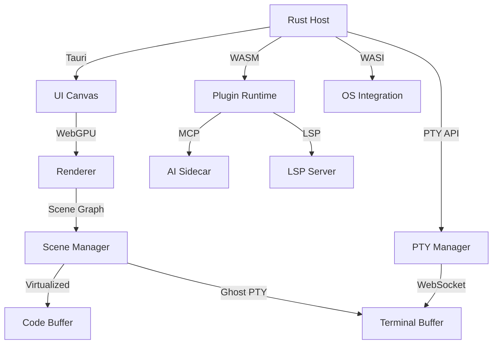

# Zénit: a desktop workspace for code, AI assistance and real execution

## Introduction
Zénit is not another text editor with a few extra panels. It is a desktop environment where code, AI, and running processes share a single address space. The core idea is to eliminate the context switching that kills developer flow: you should not have to copy a stack trace from a terminal, paste it into a web chat, wait for a response, then paste the fix back into an editor that has already lost the original file state. Instead, Zénit keeps the terminal, the diff, and the LLM inference inside one persistent process tree, all accessible from a 120 fps canvas.

## Why This Matters
Modern AI‑assisted coding tools treat the model as a remote service. They work well for isolated snippets but fail when the task involves a live database, a background worker, or a device driver. The result is a fragmented workflow: you run `docker compose up`, see an error, switch to a browser tab, ask a chatbot, get a suggestion that ignores your current schema, and then discover the container has stopped. Zénit collapses that loop by making the execution environment a first‑class citizen, not a side‑effect.

## How It Works
The system is built around three cores that communicate through well‑defined boundaries.



1. **Host (Rust/Tauri)** – Owns the window, processes, and OS capabilities. It spawns the plugin runtime, the AI sidecar, and the PTY manager.  
2. **Runtime (WASM Component Model)** – A language‑agnostic sandbox. Each plugin (LSP, DAP, task runner) is a WASI component that negotiates capabilities at load time.  
3. **Canvas (WebGPU/Canvas 2D)** – A retained‑mode scene graph that draws code, terminals, and diff overlays without using the DOM. Input events are routed through the host, which decides which pane receives focus.

The PTY subsystem is the most critical piece for “real execution”. It is a set of *Ghost PTYs* – pseudoterminals that live in the Rust process and survive UI crashes. When the frontend reconnects, the PTY manager replays the buffered output and restores the window size.

## Core Concepts
- **Tri‑Core Model** – Host, Runtime, Canvas are separate processes with explicit contracts. This isolates a crash in the UI from the terminal session.  
- **Ghost PTY** – A PTY master/slave pair owned by the host. The master is exposed to the frontend over a WebSocket. The slave is attached to the user’s shell. If the UI dies, the shell keeps running; on reconnect, the master resumes streaming.  
- **Sidecar AI** – The LLM runs as a local process (llama.cpp, ollama, or vllm) and speaks the Model Context Protocol over a Unix socket. It is treated like any other language server, not a cloud API.  
- **Diff‑Aware Context Windowing** – Instead of feeding the entire repository to the model, we send the LSP semantic graph (call hierarchy, type definitions), the uncommitted diff, and the visible terminal scrollback. This keeps the token budget deterministic.  
- **WASM Components** – Plugins are compiled to WASI preview 2. They start in ~2 ms and can be written in Rust, Go, or TypeScript (via a thin WASM glue). Capability requests (file system, network) are prompted just‑in‑time.

## Examples & Code Walkthrough

### Ghost PTY Manager (Rust)
```rust
use std::os::unix::io::AsRawFd;
use std::process::{Command, Stdio};
use tokio::io::{AsyncReadExt, AsyncWriteExt};
use tokio::net::UnixStream;
use nix::pty::{openpty, Winsize};

/// A pseudoterminal that can survive UI restarts.
struct GhostPty {
    /// Master side, wrapped for async I/O.
    master: tokio::io::UnixStream,
    /// Child process handle, if still running.
    child: Option<std::process::Child>,
}

impl GhostPty {
    /// Spawn a new shell inside a PTY.
    async fn spawn(shell: &str, rows: u16, cols: u16) -> anyhow::Result<Self> {
        let winsize = Winsize {
            ws_row: rows,
            ws_col: cols,
            ws_xpixel: 0,
            ws_ypixel: 0,
        };
        let pty = openpty(None, Some(&winsize))?;
        let master_fd = pty.master;
        let slave = pty.slave;

        let mut cmd = Command::new(shell);
        cmd.stdin(Stdio::from(slave));
        cmd.stdout(Stdio::from(slave));
        cmd.stderr(Stdio::from(slave));
        // Inherit the controlling terminal.
        cmd.process_group(0);
        let child = cmd.spawn()?;

        // Convert master fd to a tokio‑compatible stream.
        let master_stream = UnixStream::from_raw_fd(master_fd);
        Ok(Self {
            master: master_stream,
            child: Some(child),
        })
    }

    /// Resize the terminal (e.g., when the window changes).
    async fn resize(&mut self, rows: u16, cols: u16) -> anyhow::Result<()> {
        let winsize = Winsize {
            ws_row: rows,
            ws_col: cols,
            ws_xpixel: 0,
            ws_ypixel: 0,
        };
        // SAFETY: master_fd is valid for the lifetime of this struct.
        let fd = self.master.as_raw_fd();
        nix::pty::tcsetwinsize(fd, winsize)?;
        Ok(())
    }

    /// Read available output from the PTY.
    async fn read(&mut self, buf: &mut [u8]) -> anyhow::Result<usize> {
        Ok(self.master.read(buf).await?)
    }

    /// Write user input to the PTY.
    async fn write(&mut self, data: &[u8]) -> anyhow::Result<usize> {
        Ok(self.master.write(data).await?)
    }

    /// Kill the child process and clean up.
    async fn kill(&mut self) -> anyhow::Result<()> {
        if let Some(mut child) = self.child.take() {
            child.kill()?;
            child.wait()?;
        }
        Ok(())
    }
}
```
The manager stores a `HashMap<String, GhostPty>` keyed by workspace ID. When the UI disconnects, the host keeps the PTY alive. On reconnect, it sends the current buffer state and resumes streaming.

### ContextAssembler (Rust Trait)
```rust
use std::collections::HashMap;

/// A trait for building deterministic token budgets for LLM context.
pub trait ContextAssembler {
    fn assemble(
        &self,
        diff: &[u8],
        semantic_graph: &SemanticGraph,
        terminal_scrollback: &[u8],
        max_tokens: usize,
    ) -> String;
}

pub struct DefaultAssembler;

impl ContextAssembler for DefaultAssembler {
    fn assemble(
        &self,
        diff: &[u8],
        semantic_graph: &SemanticGraph,
        terminal_scrollback: &[u8],
        max_tokens: usize,
    ) -> String
